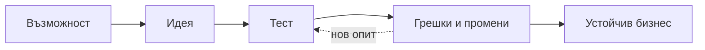
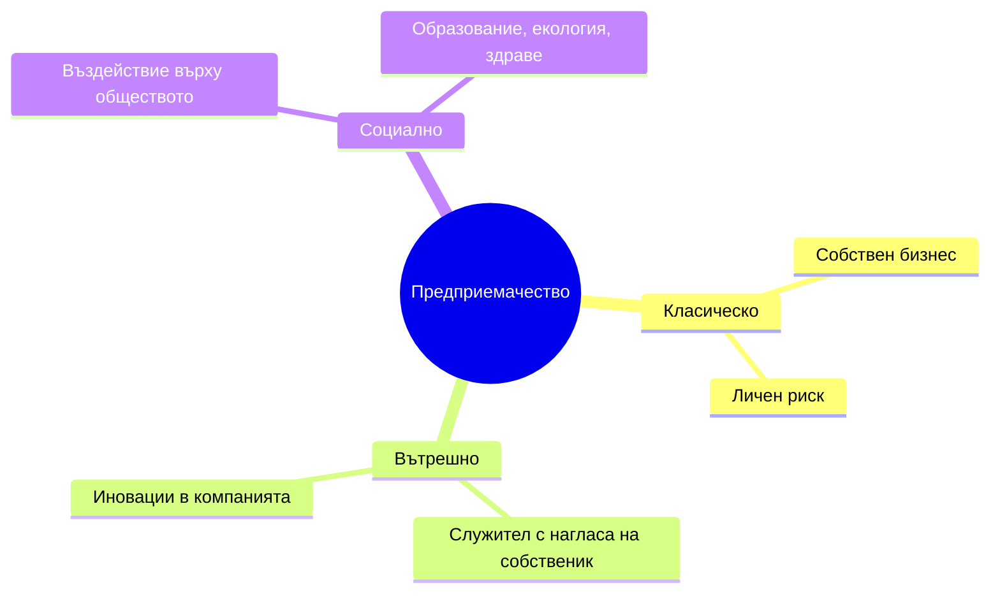

# Модул 01. Предприемачеството в дигиталната епоха

## Цели на урока

След този урок ученикът може да:

* различи стартъп от малко и средно предприятие (МСП) по начина, по който използват дигиталните иновации;
* обясни трите типа предприемачество: класическо, вътрешно и социално;
* сравни предприемача (entrepreneur) с вътрешния предприемач (intrapreneur);
* разпознае шестте типа предприемачи и да открие кой тип е най-близо до него.

## 1. Добре дошли в света на иновациите

Когато чуете думата „иновация“, вероятно си представяте големи открития, известни компании или модерни технологии. Истината е, че иновациите са навсякъде около нас: в начина, по който учим, общуваме, пазаруваме и дори прекарваме свободното си време.

През тази година ще започнем от най-важното: каква е разликата между изобретение, подобрение и иновация. Ще разгледаме дигиталните иновации с примери от България (Payhawk, Dronamics, EnduroSat) и от света (Airbnb, Uber, Coursera). Ще работим с Canva, Google Workspace, онлайн бели дъски и AI приложения. И най-важното: няма да останем в теорията. Ще работим в екипи, ще създаваме свои малки проекти и ще се упражняваме да мислим креативно и да представяме решения.

> **Опитай сам.** Запиши три неща, които си направил тази седмица с телефона си и които преди 10 години са били невъзможни или много по-трудни. Коя компания стои зад всяко от тях?

## 2. Стартъп или малко и средно предприятие

Когато говорим за дигитално предприемачество, трябва ясно да разграничим стартъпите от малките и средни предприятия (МСП). Двете често се бъркат, но подходът им към дигиталните иновации е коренно различен.

**Стартъпите** тръгват с голяма визия: нов продукт, технология или бизнес модел, който може да „разклати“ пазара. Те използват дигиталните иновации като оръжие за бърз растеж и глобално разширяване. Рискът е висок, но и амбицията е да се създаде нещо, което променя правилата на играта.

**МСП** залагат на стабилност и устойчивост. Те използват дигиталните иновации, за да оптимизират процесите си, да достигат по-ефективно до клиентите, да продават онлайн и да управляват по-добре ресурсите си. За тях дигитализацията не е „взрив“, а инструмент за предвидим и сигурен растеж.

| | Стартъп | МСП |
|---|---|---|
| Начална точка | Нова идея, често непознат пазар | Доказан модел, съществуващо търсене |
| Роля на дигиталното | Двигател на растежа | Инструмент за ефективност |
| Риск | Висок | Умерен |
| Цел | Бърз растеж, мащаб, често глобален пазар | Стабилност, печалба, устойчивост |
| Пример | Платформа за виртуално пробване на дрехи с AI | Онлайн магазин за дрехи |

### Пример

Представете си онлайн магазин за дрехи. Това е бизнес с доказан модел: хората знаят как да поръчват, клиентите съществуват още преди да стартирате. От другата страна е стартъп, например платформа за виртуално пробване на дрехи чрез изкуствен интелект. Тук няма гарантирани клиенти, защото услугата е нова. Трябва първо да убедите хората защо изобщо имат нужда от нея.

Грешката е да гледаме само външните белези: офиси, екипи, социални придобивки. Истинските разлики са в мисленето: как се възприемат дигиталните иновации, как се подхожда към пазара и какви стратегии за растеж се избират. Няма универсален път. Въпросът е да избереш своето ДНК.

> **Опитай сам.** Посочи по два български примера за стартъп и за МСП. Подсказка за стартъпи: Payhawk, EnduroSat, Dronamics. За МСП помисли за пекарната, автосервиза или книжарницата в твоя квартал. Как всеки от тях използва дигиталните технологии?

## 3. Същност на предприемачеството

Предприемачеството е умението да видиш възможност и да я превърнеш в работещ бизнес. То не е само идея, а процес: от теста, през грешките и промените, до устойчивия модел. Става дума за решения, не за мечти. За дисциплина и постоянство, не за случайни проблясъци.

В дигиталната епоха същността на предприемачеството е как използваш технологиите, за да създадеш реална стойност: за клиентите, за пазара и за себе си.

> **Опитай сам.** Опиши в три изречения проблем, който забелязваш в училище, и как би го превърнал във възможност за малък бизнес или проект.

## 4. Трите типа предприемачество

Предприемачеството е процесът на създаване и развиване на стойност чрез бизнес, който предизвиква промяна. Има три основни типа.

**1. Entrepreneurship (предприемачество).** Когато създаваш собствен бизнес, ти си предприемач. Предприемачът разпознава нуждите на хората, създава нови продукти, услуги или бизнес модели и превръща идеите в реалност. Дигиталните иновации му дават най-големи възможности: платформи за електронна търговия, AI решения, приложения, дигитални услуги. Днес предприемачът може не просто да открие нов пазар, а да го създаде от нулата чрез технология.

**2. Intrapreneurship (вътрешно предприемачество).** Вътрешният предприемач е служител, който мисли и действа като собственик, но в рамките на съществуваща организация. Той поема инициатива, носи нови идеи, експериментира. Това е възможно само в култури, които насърчават креативността, приемат грешките като част от процеса и споделят успеха. Вътрешните предприемачи създават нови дигитални продукти, автоматизират процеси, изграждат платформи за клиенти. Те са двигателите на дигиталната трансформация отвътре.

**3. Social entrepreneurship (социално предприемачество).** Тук мотивацията не е печалбата, а въздействието върху обществото. Социалните предприемачи разработват иновативни решения за проблеми в образованието, екологията, здравеопазването, социалното включване. Дигиталните технологии умножават ефекта им: онлайн образователни платформи, телемедицина, приложения за социална ангажираност. Така една идея може да промени хиляди животи.

> **Опитай сам.** Намери по един български пример за всеки тип. Подсказка за социално предприемачество: потърси „Заедно в час“ или „Teach for Bulgaria“ и проекта „Тийноватор“. Какъв проблем решава всеки?

## 5. Предприемач и вътрешен предприемач

| Аспект | Entrepreneur (предприемач) | Intrapreneur (вътрешен предприемач) |
|---|---|---|
| Среда на работа | Стартира собствен бизнес | Работи в съществуваща организация |
| Риск | Личен и финансов | Професионален (репутация, кариера), но не личен финансов |
| Ресурси | Сам намира финансиране, екип, инфраструктура | Използва ресурсите на компанията |
| Свобода | Пълна автономия и контрол | Ограничена от политиките на компанията |
| Мотивация | Печалба, наследство, свобода | Стойност и иновации за компанията, признание, кариера |
| Фокус | Външен пазар, нещо ново за клиентите | Вътрешен растеж, нови продукти, по-добри процеси |
| Пример | Стив Джобс (Apple), Илон Мъск (Tesla, SpaceX) | Джони Айв, дизайнерът на Apple; екипът зад Gmail в Google |

> **Опитай сам.** Представи си, че работиш в Еконт. Предложи една вътрешна иновация, която би улеснила клиентите или служителите. Какви ресурси на компанията би използвал?

## 6. Предприемач ли си? Шестте типа предприемачи

**1. Иноваторът.** Създава напълно нови идеи и ги превръща в устойчив бизнес. Не просто прави продукт, а променя начина, по който мислим и действаме. Обикновено е страстен, дори обсебен от идеята си. Истинските иноватори не просто се открояват от тълпата, а създават нова тълпа, нов пазар, ново мислене. Примери: Стив Джобс, Лари Пейдж (Google), Бил Гейтс.

**2. Борбеният (The Hustler).** Не чака наготово, не разчита някой да му даде финансиране или идеални условия. Започва малко, с това, което има. Вярва в упоритостта, труда и постоянството. Най-голямата му сила е фокусът. Пример: Марк Кюбан започва съвсем млад, като продава торби за боклук, вестници и пощенски марки. По-късно създава компания, която е придобита от Yahoo!. Поуката: не е важно откъде тръгваш, а с какво постоянство вървиш.

**3. Имитаторът (The Imitator).** Взема съществуваща идея и я подобрява: прави продукта по-добър, по-достъпен или по-ефективен. Пример: Alibaba идва след Amazon, но със собствен модел, адаптиран към нуждите на азиатския пазар. Не е нужно винаги да измисляш изцяло нова идея.

**4. Изследователят (The Researcher).** Никога не бърза. Първо събира данни, анализира, проверява и тества, за да сведе риска до минимум. За него бизнесът започва, когато шансовете за успех са високи и добре аргументирани.

**5. Визионерът (The Visionary).** Вижда бъдещето, преди то да се е случило. Разпознава тенденции там, където другите още не гледат, и изгражда нови индустрии. В началото често изглежда „странен“, защото идеите му звучат нереалистично. Пример: Илон Мъск, когато говореше за електромобили и мисии до Марс.

**6. Купувачът (The Buyer).** Не започва от нулата. Силата му е да разпознае съществуващ бизнес с потенциал, да го придобие и да намери правилните хора да го развият. Пример: Уорън Бъфет, който превърна инвестирането и придобиванията в изкуство.

> **Опитай сам.** Направи си кратък тест: кои две описания най-много приличат на теб? Запиши по един пример от живота си, който го доказва. После попитай съученик кой тип вижда в теб. Съвпадат ли отговорите?

## Въпроси за дискусия

1. Кой е по-ценен за една страна: стартъпът, който може да стане „еднорог“, или стотиците МСП, които дават работа в малките градове?
2. Защо в някои компании вътрешните предприемачи процъфтяват, а в други се отказват?
3. Може ли един човек да бъде различен тип предприемач в различни етапи от живота си?

## Ключови термини

| Термин | Превод |
|---|---|
| Startup | стартъп, нова компания с модел за бърз растеж |
| SME | малко и средно предприятие (МСП) |
| Entrepreneur | предприемач |
| Intrapreneur | вътрешен предприемач |
| Social entrepreneur | социален предприемач |
| Unicorn | „еднорог“, стартъп с оценка над 1 млрд. долара |
| Hustler | борбен предприемач |
