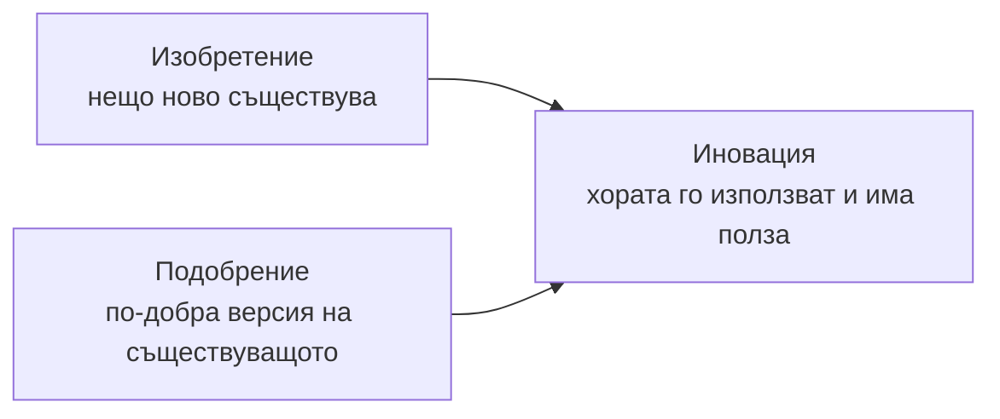
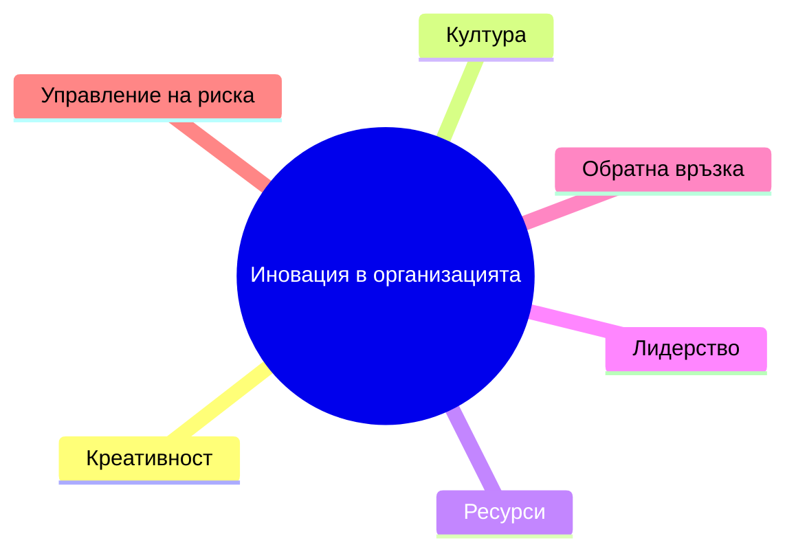

# Модул 02. Изобретение, подобрение, иновация

## Цели на урока

След този урок ученикът може да:

* обясни разликата между изобретение и иновация;
* даде исторически и съвременни примери, при които изобретателят и иноваторът са различни хора;
* обясни защо иновацията е повече от нов продукт;
* назове основните компоненти, които правят иновацията възможна в една организация.

## 1. Две думи, които не са синоними

Термините „изобретение“ и „иновация“ често се използват взаимозаменяемо. Това е неточно и пропуска важни нюанси.

* **Изобретение** е откриването на нещо ново.
* **Иновация** е прилагането на нова идея или метод, или подобряването на съществуваща идея (продукт, услуга), така че тя да носи реална полза.
* **Подобрение** е по-малка промяна на нещо, което вече съществува и работи.

Иновацията превръща изобретенията в практични продукти или процеси. Мнозина смятат, че успешното предприемачество започва с изобретение, а след това идва „само изпълнението“. Тази гледна точка подценява рисковете и разликите между двете.

> **Опитай сам.** Вземи три предмета от раницата си. За всеки определи: какво е било изобретението в основата му и каква е иновацията, благодарение на която го имаш днес?

## 2. Дефинициите по-подробно

**Какво е изобретение?** Първоначалното създаване на продукт или процес, неговата първа поява. То адресира конкретен проблем чрез технология. Патентоспособността на изобретението зависи от техническия му характер. Често го описват като „инструкция за техническо действие“.

**Какво е иновация?** Думата идва от латинския глагол *innovāre*, „въвеждам нови неща, идеи или начини на действие“. Като процес иновацията се свързва с подобрение и трансформация, но също и с това да правиш нещо изцяло различно, а не просто по-добре.

| Основа за сравнение | Изобретение | Иновация |
|---|---|---|
| Значение | Изцяло нова идея за продукт или процес | Прилагането на идея, въведена за първи път на пазара |
| Какво е то | Оригинална идея и теоретичното ѝ функциониране | Добавяне на стойност към нещо съществуващо |
| Необходими умения | Предимно научни | Маркетингови, технически и стратегически |
| Кога се случва | Когато идея хрумне на учен или изобретател | Когато има нужда от нов продукт или подобрение |
| Обхват | Един продукт или процес | Интеграция на различни продукти и процеси |
| Кой участва | Основно отделът за научна и развойна дейност (R&D) | Цялата организация и много заинтересовани страни |

> **Опитай сам.** Намери в Google Patents (patents.google.com) един патент на български изобретател. Стигнал ли е до пазара като иновация? Ако не, какво според теб е липсвало?

## 3. Защо изобретателят не винаги е иноваторът

Много изобретатели никога не виждат творенията си реализирани, защото са пропуснали детайли или защото успехът идва по-късно чрез съвсем други хора.

Икономистът Йозеф Шумпетер прави ясно разграничение между процеса на изобретяване и процеса на иновация. Според него в стартиращите компании именно иноваторите, а не изобретателите, поемат водещата роля. Революционните изобретения често се нуждаят от време, за да станат готови за пазара, и срещат съпротива.

Американският икономист Израел Кирцнер говори за „откриване на вече съществуващото“: предприемачът разпознава потенциала на идеи, които вече съществуват. Ярък пример е факс машината: изобретена е много отдавна, но реалният ѝ пазарен успех идва чрез други компании.

### Пример: Xerox и Apple

В изследователския център на Xerox в Пало Алто (PARC) създават компютърната мишка и графичния потребителски интерфейс (GUI) с икони и прозорци. Но Apple, а по-късно и други компании, ги внедряват в персонални компютри и ги правят достъпни за милиони хора. Изобретението е на Xerox, иновацията е на Apple.

> **Опитай сам.** Потърси историята на българския изобретател Джон Атанасов и първия електронен цифров компютър. Кои компании превърнаха идеята за компютъра в масова иновация?

## 4. Изобретения, които станаха иновации

| Изобретение | Иновацията след него |
|---|---|
| Микропроцесор (Тед Хоф и Федерико Фаджин, Intel) | Безброй електронни устройства и основите на дигиталната епоха |
| Електрическа крушка (Томас Едисон) | Електрификация на градовете и цяла индустрия за осветление |
| Цип (Гидеон Сундбек) | Нови дизайнерски и функционални възможности в дрехи и чанти |
| Транзистор и соларна клетка (Bell Labs) | Модерната електроника, комуникациите, възобновяемата енергия |
| Компютърна мишка (Дъглас Енгелбарт) | Нов начин на работа с персоналния компютър |
| Телефон (Александър Греъм Бел) | Глобалната телекомуникационна индустрия |
| Пеницилин (Александър Флеминг) | Масово производство на антибиотици, спасени милиони животи |
| Печатна преса (Йоханес Гутенберг) | Разпространение на знанието и образованието |
| Парна машина (Джеймс Уат и други) | Индустриалната революция |
| Интернет (много учени и организации) | Електронна търговия, социални мрежи, дигитална трансформация |

> **Опитай сам.** Добави към таблицата пример от последните 5 години: изобретение или технология, която в момента се превръща в иновация пред очите ни. Подсказка: помисли за генеративния AI, електрическите тротинетки или плащането с телефон.

## 5. Защо иновацията е повече от нови продукти

Пазарите се променят бързо и уникалното предимство на всеки нов продукт може скоро да се стопи. Днешните „звезди на пазара“ утре могат да станат обикновени, взаимозаменяеми стоки. Затова компаниите трябва да иновират постоянно, а не веднъж. Глобалната дигитализация допълнително засилва този натиск, особено в сферата на услугите.

**Значението на изобретенията:** създават изцяло нови идеи, доказват научното знание, изискват специфична експертиза, често водят до неочаквани резултати и служат като градивни елементи за иновациите.

**Значението на иновациите:** усъвършенстват съществуващи идеи, носят техническо или конкурентно предимство, изискват широк набор от умения, привличат таланти и възникват, когато в една организация има нужда от промяна.

> **Опитай сам.** Сравни как изглеждаше приложението или сайтът на твоята банка или мобилен оператор (A1, Yettel, Vivacom) преди няколко години и сега. Използвай Wayback Machine (web.archive.org). Каква иновация в услугата забелязваш?

## 6. Да обобщим

Иновацията е процес на създаване и въвеждане на нови идеи, методи, продукти, услуги или решения, които имат значително положително въздействие и добавена стойност. Тя не се ограничава до технологиите. Обхваща нови подходи към проблемите, организационни практики, процеси и бизнес модели. В същността си иновацията означава да предизвикаш статуквото, да мислиш извън рамките и да поемаш премерени рискове.

> **Опитай сам.** Напиши своя дефиниция за иновация в едно изречение, без да преписваш от урока. Сравни я с тези на трима съученици и изберете най-ясната.

## 7. Какво прави иновацията възможна в една организация

1. **Креативност и идеи.** Горивото на иновациите.
2. **Култура на иновации.** Ценности и поведение, които подкрепят любопитството, риска, сътрудничеството и експериментите.
3. **Ресурси и инфраструктура.** Финансиране, хора, технологии, достъп до данни.
4. **Лидерство и визия.** Лидерите задават посоката, дават смисъл и ресурси, водят с личен пример.
5. **Обратна връзка и адаптация.** Постоянен цикъл на обратна връзка от клиенти и пазара.
6. **Управление на риска.** Иновацията винаги носи несигурност, която трябва да се управлява.

> **Опитай сам.** Оцени училището си по шестте компонента от 1 до 5. Кой е най-силен и кой най-слаб? Предложи една конкретна стъпка за най-слабия.

## Въпроси за дискусия

1. Ако Xerox е изобретил мишката, защо днес помним Apple? Справедливо ли е това?
2. Може ли една иновация да не съдържа нито едно ново изобретение? Дай пример.
3. Иновация ли е, ако твоята баба започне да плаща сметките си през приложение?

## Ключови термини

| Термин | Превод |
|---|---|
| Invention | изобретение |
| Innovation | иновация |
| Improvement | подобрение |
| R&D, research and development | научноизследователска и развойна дейност |
| Patent | патент |
| Commercialisation | комерсиализация, излизане на пазара |
