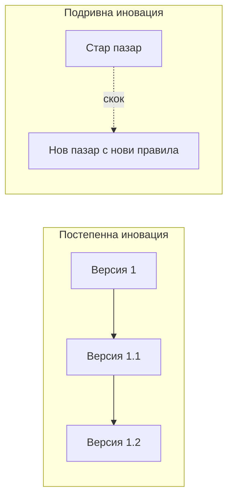
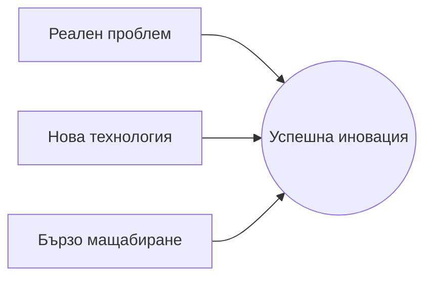

# Модул 03. Видове иновации и пробиви, които промениха индустрии

## Цели на урока

След този урок ученикът може да:

* различи основните видове иновации и да даде пример за всеки;
* обясни разликата между постепенна и подривна иновация;
* анализира световни и български примери за иновации;
* изведе общата формула, която стои зад успешните иновации.

## 1. Видовете иновации: двигателите на съвременния бизнес

| Вид | Какво е | Пример |
|---|---|---|
| Продуктова | Нови или подобрени продукти | Смарт часовник, който следи сърдечния ритъм |
| Процесна | По-ефективни вътрешни процеси и технологии | Автоматизиран склад на eMAG |
| В бизнес модела | Нов начин за създаване, доставяне и улавяне на стойност | Абонамент вместо еднократна покупка |
| Сервисна (услугова) | Ново клиентско преживяване, персонализация, достъпност | Проследяване на пратка в реално време при Еконт |
| Инкрементална (постепенна) | Малки, но постоянни подобрения | Всяка нова версия на едно приложение |
| Дисруптивна (подривна) | Радикални решения, които изместват утвърдените играчи | Стрийминг срещу видеотеките |
| Отворена | Иновации заедно с клиенти, университети, стартъпи | Компания, която кани студенти в хакатон |
| Устойчива | Екологични продукти и модели | Многократни опаковки за доставка |
| Социална | Решения за обществени проблеми | Платформа за доброволци |
| Дигитална | Иновации чрез AI, IoT, блокчейн | Умен дом с приложение |
| Технологична | Нововъведения в науката и технологиите | Биотехнологии, възобновяема енергия |

> **Опитай сам.** Избери Lidl България или Kaufland. Намери поне три вида иновации, които прилагат: например приложение за лоялност (сервисна, дигитална), каси на самообслужване (процесна), собствени марки с устойчиви опаковки (устойчива).

## 2. Постепенни и подривни иновации

* **Continuous, непрекъснати (постепенни) иновации** са малки подобрения, които поддържат конкурентоспособността.
* **Discontinuous, прекъсващи (подривни) иновации** са радикални трансформации, които променят пазарите и задават нови стандарти.

Комбинирането на различни видове иновации в целенасочена стратегия води до устойчив растеж и пазарно лидерство.

> **Опитай сам.** Посочи по една постепенна и една подривна иновация в индустрия, която те интересува (музика, игри, транспорт, мода). Каква е разликата във въздействието им?

## 3. Пробиви, които промениха цели индустрии

* **Airbnb** трансформира пътуванията с модела „от човек към човек“: собствениците отдават стаи или цели имоти. Платформата създаде споделена икономика, базирана на доверие.
* **Tesla** не изобрети електромобила, но го направи желан и мащабируем чрез батерии, софтуер и дизайн.
* **3D печат** позволява бързо прототипиране и производство в малки серии: протези в медицината, олекотени части в авиацията.
* **CRISPR** позволява на учените да редактират гени с безпрецедентна точност и преосмисля медицината и земеделието.
* **Netflix** започна с доставка на DVD по пощата и се превърна в глобална платформа за стрийминг.
* **Мобилните плащания** (Apple Pay, Google Pay, PayPal) направиха транзакциите бързи и сигурни.
* **Amazon Alexa** донесе гласовия асистент в масовия пазар.
* **Градската микромобилност** (Lime, Bird) популяризира споделените електрически тротинетки за „последната миля“.

> **Опитай сам.** Избери един от пробивите и намери как изглежда той в България днес. Например: има ли споделени тротинетки в твоя град, кои банки поддържат Apple Pay и Google Pay, какви са правилата за Airbnb?

## 4. Български примери за иновации

**EnduroSat.** Разработва и изстрелва малки спътници с модулна архитектура, която позволява на бизнеси, университети и организации да провеждат космически мисии по-бързо и достъпно. Поставя България на картата на световните космически иновации.

**Shelly Group** (бившата Allterco). Създава умни устройства за автоматизация на дома и бизнеса (интернет на нещата, IoT). През 2025 г. става първата публично търгувана българска технологична компания с пазарна капитализация над 1 млрд. долара, а устройствата ѝ се използват в над 130 държави.

**Telerik.** Започва като малък софтуерен продукт за потребителски интерфейси. Четирима българи го превръщат в компания с глобално признание, която по-късно е придобита от американската Progress Software.

**SoftUni.** Образователен модел за практическо обучение по програмиране и дигитални умения, превърнал се в екосистема, която свързва обучение, практика и бизнес и променя начина, по който младите хора влизат в IT индустрията.

**Payhawk.** Софтуер за управление на корпоративни разходи, превърнал се в глобално финтех решение. Payhawk става първият български „еднорог“, компания с оценка над 1 млрд. долара.

**Dronamics.** Разработва товарни дронове за доставки на средни разстояния, с които иска да направи бързата доставка достъпна за повече места по света.

| Компания | Изобретението | Иновацията |
|---|---|---|
| Telerik | Софтуерен продукт за интерфейси | Глобална софтуерна компания |
| SoftUni | Модел за практическо обучение | Образователна екосистема, свързана с бизнеса |
| Payhawk | Софтуер за разходи | Финтех решение за компании в много държави |

> **Опитай сам.** Отвори сайта на EnduroSat, Shelly или Dronamics. Запиши: какъв проблем решават, за кого, каква е иновацията. После потърси новина за тях от последните 6 месеца.

## 5. Какво ни учат тези примери

Всеки пример разкрива една закономерност: **успешната иновация решава реален проблем, използва нова технология и се мащабира бързо.** Тя не следва статуквото, а го предизвиква.

> **Опитай сам.** Провери формулата върху едно приложение, което ползваш всеки ден. Кой е реалният проблем, коя е технологията и как е мащабирано?

## Въпроси за дискусия

1. Защо Tesla се смята за иноватор, след като електромобилите съществуват отдавна?
2. Какво трябва да има в една страна, за да се раждат повече компании като Payhawk и EnduroSat?
3. Всяка подривна иновация ли е добра за обществото? Кой губи?

## Ключови термини

| Термин | Превод |
|---|---|
| Product / process innovation | продуктова / процесна иновация |
| Business model innovation | иновация в бизнес модела |
| Incremental innovation | постепенна иновация |
| Disruptive innovation | подривна иновация |
| Open innovation | отворена иновация |
| IoT, Internet of Things | интернет на нещата |
| Peer-to-peer | „от човек към човек“ |
| Scaling | мащабиране |
