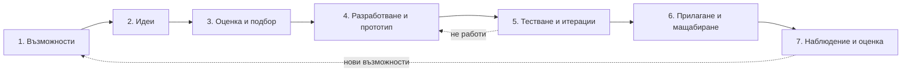
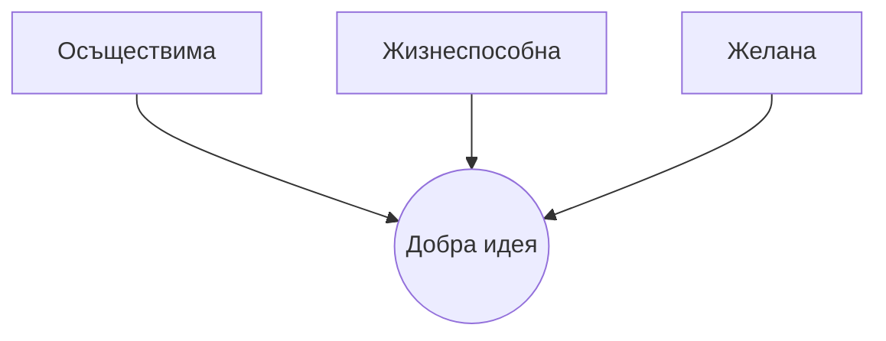

# Модул 04. Иновацията като процес

## Цели на урока

След този урок ученикът може да:

* опише седемте стъпки на процеса на иновации;
* обясни защо иновацията е цикъл, а не еднократно събитие;
* приложи стъпките към малък училищен или бизнес проект;
* разпознае грешките, които спират иновациите по пътя.

## 1. Иновацията не е проблясък, а процес

Често си представяме иновацията като момент „Еврика!“. В реалността идеите стават иновации чрез поредица от стъпки, които организациите следват, за да насърчат и приложат нещо ново. Подходите се различават, но най-често срещаните стъпки са седем.

> **Опитай сам.** Помисли за последната промяна в училището ти (нов график, ново приложение, ново правило). През кои от седемте стъпки е минала и коя е била пропусната?

## 2. Стъпка 1. Идентифициране на възможности

Откриваме възможности чрез пазарни проучвания, обратна връзка от клиенти, анализ на тенденции или вътрешни оценки. Търсим неудовлетворени нужди, нови тенденции или области за подобрение.

> **Опитай сам.** Прочети 20 отзива в Google Maps за кафене или фитнес в твоя квартал. Запиши трите най-чести оплаквания. Това са възможности за иновация.

## 3. Стъпка 2. Генериране на идеи

Създаваме широк спектър от идеи чрез брейнсторминг, състезания за идеи, обратна връзка от клиенти или сътрудничество между отделите. На този етап количеството е по-важно от качеството.

> **Опитай сам.** Вземи едно от оплакванията от предишната задача и запиши 10 идеи за решение за 5 минути. Без да ги оценяваш.

## 4. Стъпка 3. Оценка и подбор

Анализираме всяка идея по три въпроса:

* **Осъществима ли е** (технически и с наличните ресурси)?
* **Жизнеспособна ли е** (може ли да носи приходи или да се поддържа)?
* **Желана ли е** (искат ли я хората)?

Добавяме пазарния потенциал, съответствието със стратегическите цели и очаквания ефект.

> **Опитай сам.** Оцени трите си най-добри идеи по трите въпроса с оценка от 1 до 5. Коя печели?

## 5. Стъпка 4. Разработване и прототипиране

Избраните идеи се превръщат в прототипи, макети или минимално жизнеспособни продукти (MVP, minimum viable product). Целта е да тестваме и валидираме концепцията, преди да инвестираме много.

> **Опитай сам.** Направи хартиен прототип на приложение за идеята си: три екрана, нарисувани на лист. Не повече от 15 минути.

## 6. Стъпка 5. Тестване и итерации

Прототипът се тества с реални потребители. Събираме обратна връзка, подобряваме и тестваме отново. Този цикъл валидира предположенията и разкрива проблеми, преди да е станало скъпо.

> **Опитай сам.** Покажи хартиения прототип на трима души извън класа. Не обяснявай, само ги помоли да „използват“ екраните. Запиши къде се объркаха.

## 7. Стъпка 6. Прилагане и мащабиране

Изготвяме план за внедряване, разпределяме ресурси и излизаме на пазара или въвеждаме иновацията в организацията.

> **Опитай сам.** Напиши план от 5 реда за въвеждане на идеята си в цялото училище: кой, какво, кога, с какви ресурси, как ще разберем, че работи.

## 8. Стъпка 7. Наблюдение и оценка

След внедряването следим ключови показатели за успех, правим корекции и извличаме уроци за бъдещи иновации. Иновациите са непрекъснат процес: организациите трябва да събират обратна връзка, да учат от успехите и провалите и да подобряват самия процес на иновации.

> **Опитай сам.** Избери два показателя, по които би измерил успеха на идеята си след един месец. Как ще ги събереш?

## Въпроси за дискусия

1. Коя стъпка според вас най-често се пропуска в малките фирми? Защо?
2. Кога е по-добре да спрете една идея на стъпка 3, отколкото да стигнете до стъпка 6?
3. Как изглежда „провалът“ в процеса на иновации и защо не е непременно лош?

## Ключови термини

| Термин | Превод |
|---|---|
| Opportunity | възможност |
| Ideation | генериране на идеи |
| Feasibility | осъществимост |
| Viability | жизнеспособност |
| Desirability | желаност |
| Prototype | прототип |
| MVP, minimum viable product | минимално жизнеспособен продукт |
| Iteration | итерация, повторение с подобрение |
| Scaling | мащабиране |
