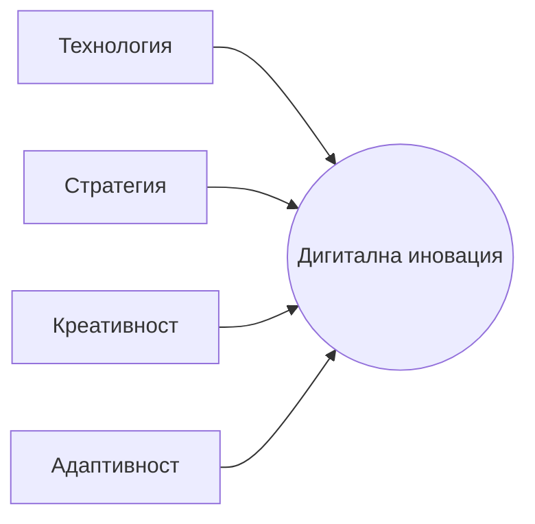
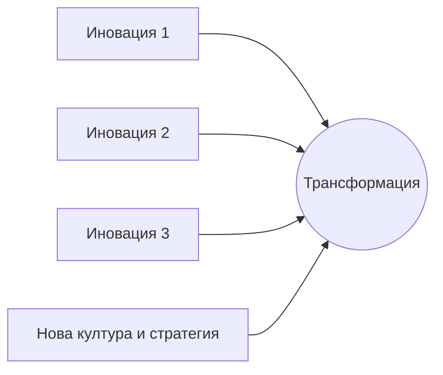

# Модул 05. Дигиталните иновации

## Цели на урока

След този урок ученикът може да:

* дефинира дигиталната иновация и да обясни какво включва;
* назове петте вида дигитална иновация с примери;
* опише ползите и предизвикателствата на дигиталните иновации;
* разграничи дигиталната иновация от дигиталната трансформация;
* предложи стратегия за дигитална иновация за малка организация.

## 1. Какво е дигитална иновация

В епоха, в която технологиите определят всичко, от начина, по който се свързваме с приятели, до това как работят бизнесите, дигиталната иновация никога не е била по-актуална.

**Дигиталната иновация** е внедряването на дигитални технологии за създаване на нови или подобряване на съществуващи бизнес процеси, продукти и услуги. Тя променя начина, по който организациите и хората решават проблеми, а не е просто покупка на ново устройство или софтуер.

Примери: автоматизиране на повтарящи се задачи, създаване на изцяло нови дигитални продукти, трансформиране на клиентското изживяване.

> **Опитай сам.** Помисли как си поръчал храна, такси или книга за последен път. Коя дигитална иновация направи това възможно и какво е било преди нея?

## 2. Какво включва дигиталната иновация

Процесът съчетава технология, стратегия, креативност и адаптивност:

* разпознаване на нови възможности чрез технологичния напредък;
* преосмисляне на традиционни операции чрез технологии;
* култура на експериментиране и учене;
* сътрудничество между отдели, с партньори и с клиенти;
* мащабиране на тестваните иновации.

> **Опитай сам.** Посети сайта на Ozone.bg или на Технополис. Намери три неща, които показват дигитална иновация (например препоръки, чат, проследяване на поръчка). Кое от четирите горни неща стои зад всяко?

## 3. Защо дигиталната иновация е важна

* **По-висока ефективност.** Инструментите оптимизират процесите, намаляват грешките и освобождават време.
* **Конкурентно предимство.** Дигитално иновативните компании реагират по-бързо.
* **По-добро клиентско изживяване.** Персонализация, лесен достъп, бърза комуникация.
* **Решения, основани на данни.** Анализите в реално време намаляват несигурността.
* **Нови приходи.** Дигитални продукти, абонаменти, онлайн пазари.

> **Опитай сам.** Избери една от петте ползи и намери пример от български бизнес. Подсказка: помисли как Glovo, Bolt или приложението на твоята банка са променили нещо във всекидневието.

## 4. Петте вида дигитална иновация

| Вид | Какво е | Пример |
|---|---|---|
| Продуктова | Нови или подобрени дигитални продукти | Облачен софтуер вместо програма на компютъра |
| Процесна | Дигитализация на бизнес процеси | Автоматично осчетоводяване на фактури |
| В бизнес модела | Нови начини за създаване на стойност и печалба | Абонамент за съдържание, плащане според употребата |
| Сервисна | Ново клиентско обслужване | Чатботове, телемедицина, онлайн записване за час |
| Маркетингова | Дигитални канали, данни, автоматизация | Персонализирани имейли, реклами в социалните мрежи |

### Примери за успешна дигитална иновация

* **Netflix** се трансформира от DVD услуга в глобална платформа за стрийминг.
* **Tesla** използва софтуер, който обновява колата дистанционно, и развива автономно шофиране.
* **Amazon** преосмисли електронната търговия чрез автоматизация и облачните услуги AWS.
* **Duolingo** направи ученето на езици глобално достъпно с геймификация, AI и данни.
* **Starbucks** използва мобилно приложение за лоялност, персонализация и предварителни поръчки.

> **Опитай сам.** Направи таблица с петте вида и за всеки намери по един пример от България. Използвай реални фирми: банки, оператори, вериги, онлайн магазини, държавни услуги (например електронно подаване на документи).

## 5. Ползи и предизвикателства

| Ползи | Предизвикателства |
|---|---|
| По-висока продуктивност и ефективност | Високи начални инвестиции |
| По-доволни клиенти | Съпротива към промяната |
| По-добро използване на данните | Сигурност и защита на личните данни |
| Разширен пазарен обхват | Нужда от постоянни обучения |
| По-добро управление на риска | Риск от неуспешни експерименти |

> **Опитай сам.** Интервюирай възрастен член на семейството си: какво го затруднява при дигиталните услуги (банкиране, онлайн записване при лекар, електронни фактури)? Кое от предизвикателствата в таблицата чуваш?

## 6. Как се създава стратегия за дигитална иновация

1. Поставете ясни цели: по-ниски разходи, растеж, по-добро преживяване.
2. Включете всички заинтересовани страни: служители, партньори, клиенти.
3. Инвестирайте в хора и дигитални умения.
4. Насърчавайте култура на експериментиране.
5. Работете гъвкаво: прототипиране, обратна връзка, адаптиране.
6. Създавайте партньорства с технологични компании или стартъпи.
7. Измервайте и коригирайте стратегията редовно.

> **Опитай сам.** Избери малък бизнес от твоя град (ресторант, автосервиз, фризьорски салон). Напиши за него стратегия за дигитална иновация в 7 реда, по един ред за всяка точка.

## 7. Дигитална иновация или дигитална трансформация

| | Дигитална иновация | Дигитална трансформация |
|---|---|---|
| Какво е | Въвеждане или подобряване на дигитални решения, продукти или практики | Цялостна промяна на организацията чрез технологии |
| Обхват | Фокусирана, поетапна | Широка, стратегическа |
| Пример | Магазин пуска приложение за поръчки | Магазинът преустройва цялата си работа: склад, доставки, продажби, обслужване |

Дигиталната иновация е начин на мислене за непрекъснато подобрение и адаптивност. Тя оформя бъдещето на учениците, професионалистите и организациите.

> **Опитай сам.** Помисли за българската държавна администрация. Дай един пример за дигитална иновация, която вече е въведена, и обясни защо това още не е цялостна дигитална трансформация.

## Въпроси за дискусия

1. Може ли една компания да е дигитално иновативна, без да е минала през дигитална трансформация?
2. Защо хората се съпротивляват на промяната, дори когато новото е по-удобно?
3. Кой трябва да плати за дигиталните умения на хората: държавата, работодателите или самите хора?

## Ключови термини

| Термин | Превод |
|---|---|
| Digital innovation | дигитална иновация |
| Digital transformation | дигитална трансформация |
| Cloud | облак, облачни услуги |
| Automation | автоматизация |
| Gamification | геймификация |
| Pay-per-use | плащане според употребата |
| Stakeholders | заинтересовани страни |
