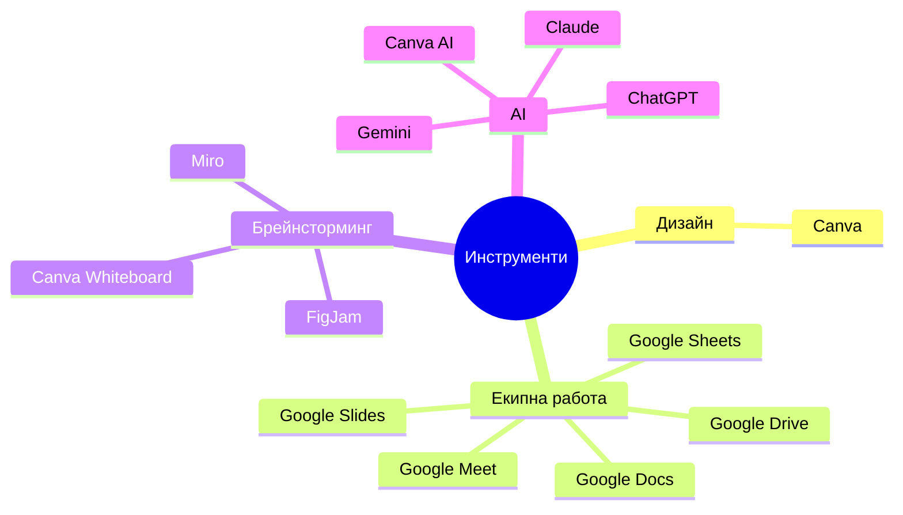

# Модул 06. Инструментите на дигиталния иноватор

## Цели на урока

След този урок ученикът може да:

* избере подходящ дигитален инструмент за дизайн, екипна работа, брейнсторминг и AI;
* организира екипен проект в облачна среда;
* използва бързи скици, интервю, SWOT и SMART цели в собствен проект;
* използва AI като помощник, а не като заместител на мисленето.

## 1. Иновациите се правят от хора с инструменти

Дигиталните иновации не се случват във вакуум. Движат ги хората, но и инструментите, които използваме. Най-достъпните и полезни за работа, създаване и сътрудничество са Canva, Google Workspace, онлайн белите дъски и инструментите с изкуствен интелект.

## 2. Canva: визуализирай идеите си

Онлайн инструмент за графичен дизайн, който прави визуалното съдържание достъпно дори без дизайнерски умения. Презентации, постери, инфографики, лога, публикации за социални мрежи. Готови шаблони и интуитивно „влачи и пусни“.

**Практическа полза:** учениците, предприемачите и екипите бързо визуализират идеи и създават материали за проекти и кампании.

> **Опитай сам.** Създайте визуална идентичност за стартиращ проект на екипа ви: лого, банер за социални мрежи и кратка презентация от 5 слайда. Цел: основи на графичния дизайн и визуалното разказване.

## 3. Google Workspace: работа в облака

* **Google Docs** за съвместно писане;
* **Google Sheets** за таблици, анализ и формули;
* **Google Slides** за презентации с общо редактиране;
* **Google Drive** за съхранение и споделяне;
* **Google Meet** за видео срещи, свързани с календара и документите.

**Практическа полза:** няма постоянно разменяне на файлове по имейл, всички работят в една среда.

> **Опитай сам.** Създайте обща папка в Google Drive за проекта на екипа. В нея: документ с описание на идеята, таблица с разпределение на задачите и сроковете, презентация на проекта. Дайте достъп на учителя.

## 4. Онлайн бяла дъска: брейнсторминг заедно

Досега в много класове се използваше Google Jamboard, но **Google спря Jamboard в края на 2024 г.** Днес същата работа вършат:

* **Canva Whiteboard** (безплатна, в същия акаунт като Canva);
* **FigJam** (от Figma, безплатен за образование);
* **Miro** (безплатен план с ограничен брой дъски).

Позволяват на екипа да визуализира идеи, да прави брейнсторминг с „лепящи листчета“, да скицира и да работи едновременно. Много полезни за дизайн мисленето: емпатия, дефиниране, идеи.

> **Опитай сам.** Проведете 15-минутен брейнсторминг на онлайн дъска по темата „Как да направим междучасията по-полезни?“. Всеки добавя поне 5 листчета, после групирайте и гласувайте с точки.

## 5. AI инструменти: помощник, не заместител

ChatGPT, Gemini (бившият Google Bard), Claude, Canva AI, Midjourney и други навлизат в образованието и бизнеса. Използват се за:

* генериране на текст: идеи, чернови, код;
* изображения и визуализации;
* автоматизация на задачи и анализ на данни;
* персонализирано обучение.

**Практическа полза:** AI спестява време и ни позволява да се съсредоточим върху креативността и стратегията. Но проверявай фактите, защото AI понякога уверено греши.

> **Опитай сам.** Помоли AI да генерира 10 бизнес идеи за ученици в твоя град. После генерирай изображение на една от тях с Canva AI. Коя идея е наистина добра и коя звучи добре, но не би работила? Защо?

## 6. Бързи скици (Sketch notes)

Не е нужно да си художник. Достатъчни са химикал и лист. Целта е да визуализираш идеи бързо и ясно, без да мислиш за красотата.

1. Вземи лист и химикал или бяла дъска.
2. Рисувай бързо и грубо.
3. Подреди идеите визуално: символи, стрелки, кутии, схеми.

> **Опитай сам.** Нарисувай за 3 минути как стигаш от дома до училище: само с кутии, стрелки и прости символи. Покажи на съученик и виж дали разбира пътя без обяснение.

## 7. Интервю с потребителя (Interview Canvas)

Използвай интервюто в началото на проекта, за да се увериш, че работиш върху правилния проблем.

**Кого да интервюираш:** заинтересовани страни, потенциални потребители, хора от изследваната среда. Дори малък брой интервюта дава полезна информация.

**Как:**

* единият води разговора, другият записва;
* задавай отворени въпроси, които не подсказват отговора;
* започни с кратко представяне и обяснение на проблема.

| Затворен въпрос (избягвай) | Отворен въпрос (използвай) |
|---|---|
| Харесва ли ви столът? | Разкажете ми за последния път, когато обядвахте в стола. |
| Бихте ли ползвали такова приложение? | Как решавате този проблем сега? |

> **Опитай сам.** Напиши 5 отворени въпроса за интервю с ученици от по-малки класове за това как подготвят домашните си. Проведи едно интервю и запиши три изненадващи неща.

## 8. SWOT анализ

Стратегически инструмент, който помага да видиш силните и слабите страни на идеята или бизнеса (вътре) и възможностите и заплахите (отвън). Използвай го, след като имаш описание на решението, за да добавиш стратегическа перспектива.

| | Полезно | Вредно |
|---|---|---|
| **Вътре** | Strengths, силни страни | Weaknesses, слабости |
| **Отвън** | Opportunities, възможности | Threats, заплахи |

> **Опитай сам.** Направи SWOT анализ на идея за училищна кафе точка, управлявана от ученици.

## 9. SMART цели

Често предприемачите казват: „Малки сме, важното е да оцелеем.“ Но ако мислиш само за оцеляване, никога няма да изградиш устойчив бизнес. Целите са като компас.

SMART целите са: **S**pecific (конкретни), **M**easurable (измерими), **A**chievable (постижими), **R**elevant (свързани със смисъла на проекта), **T**ime-bound (със срок).

Слаба цел: „Да имаме повече потребители.“
SMART цел: „До 31 март 2027 г. 150 ученици от нашето училище да използват приложението поне веднъж седмично.“

> **Опитай сам.** Напиши три SMART цели за проекта на екипа си: една за потребителите, една за продукта, една за екипа.

## Въпроси за дискусия

1. Кога AI ни помага да мислим повече и кога ни мързи да мислим?
2. Защо според вас Google спря Jamboard? Какво учи това за зависимостта от един инструмент?
3. Кое е по-ценно в екип: най-добрият инструмент или най-добрата организация?

## Ключови термини

| Термин | Превод |
|---|---|
| Collaboration | сътрудничество, екипна работа |
| Cloud workspace | работна среда в облака |
| Whiteboard | бяла дъска |
| Sketch notes | бързи визуални бележки |
| Open question | отворен въпрос |
| SWOT | силни страни, слабости, възможности, заплахи |
| SMART goals | конкретни, измерими, постижими, релевантни цели със срок |
