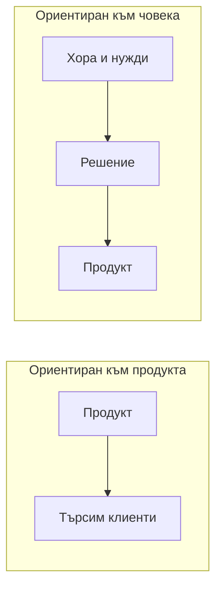
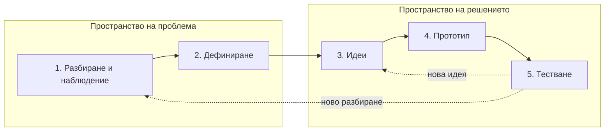

# Модул 07. Дизайн, ориентиран към човека, и дизайн мислене

## Цели на урока

След този урок ученикът може да:

* различи подхода, ориентиран към продукта, от подхода, ориентиран към човека;
* опише петте етапа на дизайн мисленето;
* разпознае погрешните представи за дизайн мисленето;
* започне собствен проект от реален проблем в своето обкръжение.

## 1. Представете си…

Човек е насред гората. От какво има нужда? Храна, вода, огън, подслон, интернет, телефон, кола, баня, дрехи, приятели, рибарски принадлежности… Списъкът може да е безкраен.

А сега се запитай: как разбра, че точно това му трябва? Това твое предположение ли е? Има ли този човек изобщо нужда от твоята помощ?

Много често смятаме, че знаем по-добре и имаме готовия отговор. Но това обикновено са наши проекции. Преди да проектираш решение, трябва да разбереш две неща:

1. Какъв е истинският проблем и защо все още съществува.
2. Кой е човекът, който го изпитва, и как изглежда проблемът през неговите очи.

Само когато разбереш потребностите и мотивациите на своята аудитория, виждаш реалната картина. Така започва пътешествието в дизайна, ориентиран към човека.

> **Опитай сам.** Напиши какво би занесъл на човека в гората. После задай на съученик 3 въпроса, сякаш той е този човек. Колко от твоите предположения се оказаха верни?

## 2. Продуктът в центъра или човекът в центъра

| | Product-centered (ориентиран към продукта) | Human-centered (ориентиран към човека) |
|---|---|---|
| Начало | Продуктът и неговите функции | Хората, техните нужди, болки, преживявания |
| Посока | Отвътре навън: първо продуктът, после човекът | Отвън навътре: първо човекът, после продуктът |
| Риск | „Най-добрият“ продукт, който никой не иска | По-бавно начало, но решение със смисъл |

> **Опитай сам.** Намери пример за продукт, който е направен „отвътре навън“ и не е успял (подсказка: Google Glass). И пример за продукт, който очевидно е мислен „отвън навътре“. С какво се различават?

## 3. Какво е дизайн мислене

Има различни методи за прилагане на подхода, ориентиран към човека. Един от най-ефективните и утвърдени е **дизайн мисленето (design thinking)**.

Дизайн мисленето е методология за решаване на проблеми, която позволява на хората, екипите и институциите да се съсредоточат върху нуждите на потребителите и да създават решения заедно с тях. Силата му е, че поставя човека в центъра: не като пасивен получател, а като съавтор на решението.

Дизайн мисленето е процесът. Мисленето, ориентирано към човека, е философията зад него.

## 4. Петте етапа

Дизайн мисленето е нелинеен процес, който се повтаря. Можем да се връщаме назад, когато научим нещо ново.

1. **Разбиране и наблюдение.** Влизаме в света на потребителя и гледаме проблема през неговите очи.
2. **Дефиниране.** Анализираме събраната информация и формулираме ясно проблема.
3. **Идеи.** Генерираме много възможни решения. Количеството е важно.
4. **Прототип.** Превръщаме идеите в прости и бързи модели, които служат за учене.
5. **Тестване.** Даваме прототипа на потребителите. Обратната им връзка показва кое работи.

В следващите модули ще работим по първите три етапа с конкретни инструменти. Прототипът и тестването ще ги развием в модула за Lean Startup.

> **Опитай сам.** Подреди тези действия по етапи: „правим анкета в стола“, „рисуваме макет на приложение“, „пишем изречение какъв е проблемът“, „даваме макета на петима ученици“, „измисляме 30 идеи“.

## 5. Погрешни представи за дизайн мисленето

* **Не е само за дизайнери.** Прилага се в бизнеса, образованието, здравеопазването, технологиите.
* **Не е за прости задачи от типа 1+1.** Работи най-добре при сложни проблеми, които имат повече от едно решение.
* **Не е магия.** Не гарантира успех. Изисква усилие, дисциплина и активен екип.
* **Не е за всеки проблем.** Някои проблеми имат ясни технически решения, като строежа на мост. Там експертите дават отговора. Дизайн мисленето е за сложни, системни проблеми, при които потребителят най-добре преценява дали решението има смисъл за него.

> **Опитай сам.** Раздели тези проблеми на подходящи и неподходящи за дизайн мислене: „Как да поправим счупен прозорец?“, „Защо учениците не четат книги?“, „Как да изчислим площта на двора?“, „Как да намалим опашките в стола?“

## 6. Пример от практиката: от сладолед до Ice Pro

Ученик, участник в програмата за млади предприемачи „Тийноватор“, започва с идея да прави сладолед. Вместо да спре дотук, той прилага дизайн мислене и проучва какво наистина искат хората.

След наблюдения и разговори разбира, че клиентите търсят не просто сладолед, а здравословна алтернатива: без захар, с протеини и натурални съставки. Така се ражда **Ice Pro**, протеинов сладолед, който съчетава вкус и здравословен избор.

**Поуката:** истинската стойност се създава, когато излезем от рамката на първоначалната идея и я пречупим през нуждите на клиента.

> **Опитай сам.** Вземи една „очевидна“ бизнес идея (кафене, магазин за дрехи, курсове по английски). Запиши 3 въпроса, които би задал на хората, преди да я започнеш.

## 7. Твоят проект за годината

Задачата ти е да намериш реален проблем в собственото си обкръжение и да приложиш процеса, за да създадеш бизнес, дипломна работа или социална инициатива. Ще използваш тези инструменти:

| Етап | Инструменти |
|---|---|
| Разбиране и наблюдение | Challenge Frame Canvas, графика „Ефективност срещу наличност“, User/Persona Anatomy Canvas |
| Дефиниране | Канва „Дефиниране на гледна точка“ |
| Идеи | Brainstorming Canvas, Idea Selection Canvas, Solution Canvas |

**Откъде да започнеш:**

1. С голям проблем, например младежката безработица в България.
2. Със среден проблем, например разликата между учебните програми и изискванията на работодателите.
3. С конкретен проблем, например липсата на стажове за ученици в местния бизнес.

> **Опитай сам.** Запиши три проблема от училището, квартала или града си: един голям, един среден и един конкретен. Избери един, по който ще работиш през следващите модули.

## Въпроси за дискусия

1. Защо хората толкова често създават продукти, които никой не иска?
2. Кое е по-трудно: да слушаш потребителя или да се откажеш от своята идея?
3. Може ли дизайн мисленето да се приложи към проблем в семейството?

## Ключови термини

| Термин | Превод |
|---|---|
| Design thinking | дизайн мислене |
| Human-centered design | дизайн, ориентиран към човека |
| Product-centered | ориентиран към продукта |
| Empathy | емпатия, съпричастност |
| Ideation | генериране на идеи |
| Prototype / test | прототип / тестване |
| Problem space / solution space | пространство на проблема / на решението |
