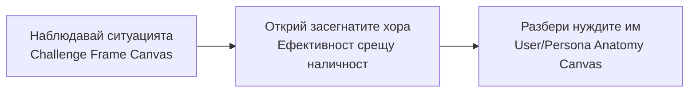
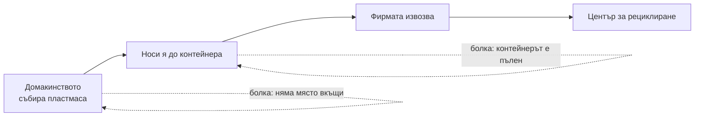
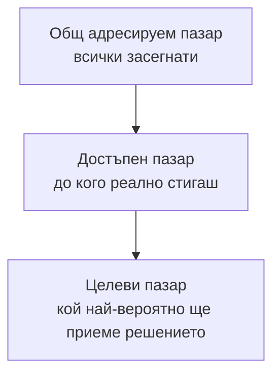
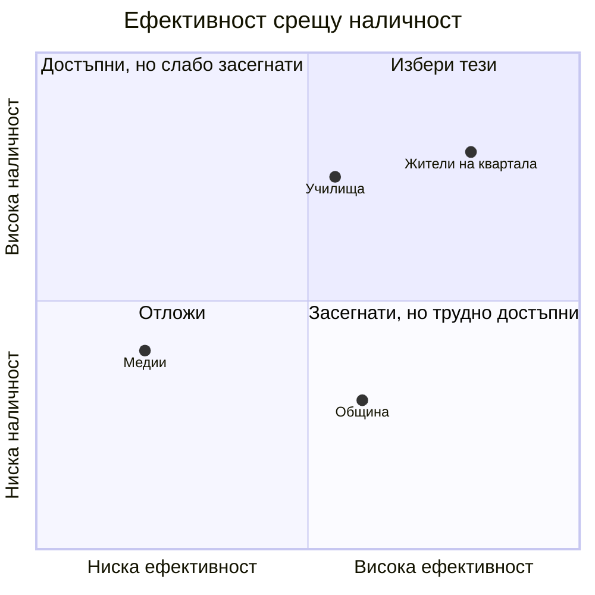
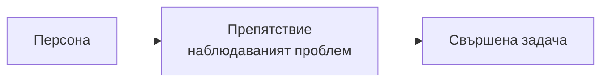
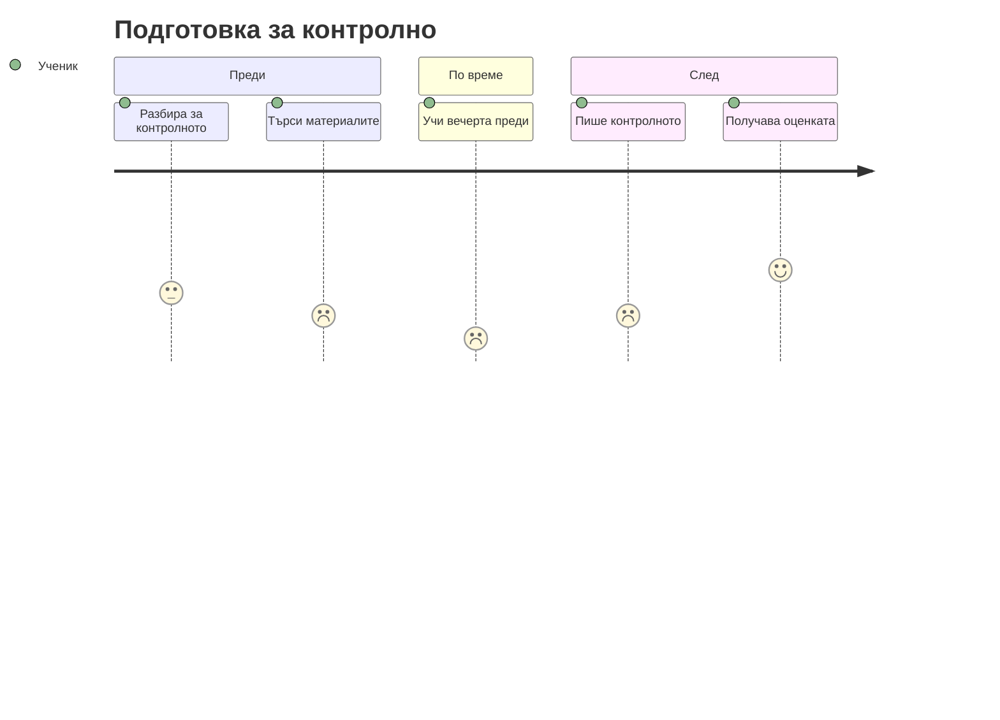

# Модул 08. Етап 1: Разбиране и наблюдение

## Цели на урока

След този урок ученикът може да:

* рамкира проблем с Challenge Frame Canvas и техниката „Лотосов цвят“;
* картографира текущата ситуация и заинтересованите страни;
* избере целеви сегмент с графиката „Ефективност срещу наличност“;
* опише персона, задачите ѝ (Jobs to be Done) и картата на преживяването ѝ;
* открие болки, ползи и контекст с User/Persona Anatomy Canvas.

## 1. Влез в света на потребителя

На този етап наблюдаваме какво правят хората, как се държат и как взаимодействат със средата си. Целта е:

* да открием реалните им проблеми;
* да влезем в пряк контакт с тях;
* да разберем как мислят и какви ценности ги водят;
* да видим ситуацията през техните очи.

**Пример:** наблюдаваш хора в супермаркет. Някои трудно намират продуктите, губят време на касата или не знаят как да използват касите на самообслужване. Ако поговориш с тях, ще откриеш истинските проблеми: нужда от по-добра навигация, по-ясни каси, по-ясна информация.

Процесът има три стъпки, всяка със свой инструмент:

> **Опитай сам.** Отиди в магазин, аптека или на спирка за 15 минути. Запиши без оценка 10 неща, които правят хората, и 3 момента, в които изглеждат затруднени или раздразнени.

## 2. Challenge Frame Canvas: рамкирай предизвикателството

Инструмент за ясно формулиране на проблема, преди да започнем да търсим решения. Помага на екипа да определи кой е засегнат, какъв е контекстът, какви са нуждите и защо проблемът още съществува.

**Стъпка 1. Област на предизвикателството.** Изберете областта (образование, екология, здраве, транспорт…) и опишете проблема с едно просто изречение. На този етап е нормално да е общо.

**Стъпка 2. Причини: техниката „Лотосов цвят“.**

1. Начертайте матрица 3 на 3.
2. В центъра запишете основния проблем.
3. Около него попълнете причините и факторите, които го поддържат.
4. Изберете една причина (подпроблем), която отговаря на вашите интереси и ресурси, и я обградете. Това е фокусът ви.

| Липса на удобни контейнери | Недостатъчна информираност | Няма стимули |
|---|---|---|
| **Нередовно извозване** | **Хората в квартала не предават пластмаса за рециклиране** | **Навикът е „всичко в един кош“** |
| Контейнерите са далече | Не знаят какво се рециклира | Никой не вижда резултат |

**Стъпка 3. Преформулирайте подпроблема** ясно и конкретно: кой е засегнат, къде и кога, какъв е ефектът. Използвайте формата „Как можем да…“ и не повече от 20 думи.

Пример: „Как можем да увеличим дела на домакинствата в квартала, които всяка седмица отделят пластмасата за рециклиране?“

Изборът на един подпроблем не значи, че той е единственият път. Общината, банка или голяма компания може да избере друг подпроблем според ресурсите си и пак да допринесе за същата цел.

> **Опитай сам.** Направи „Лотосов цвят“ за проблема, който избра в модул 07. Обгради един подпроблем и го преформулирай с „Как можем да…“ под 20 думи.

## 3. Картографирай „как е сега“

Преди да мислиш за решения, виж участниците, стъпките, пречките и зависимостите.

1. Опиши сценария в 1 до 2 изречения: контекст, място, момент.
2. Определи участниците: основни (потребители) и вторични (община, фирма, НПО, търговци).
3. Подреди стъпките на процеса във времето.
4. Отбележи точките на контакт с услуги, системи или среда.
5. Маркирай болките и нуждите на всяка стъпка.
6. Добави правила, графици, такси, разстояния.
7. Свържи причините и следствията със стрелки.
8. Провери картата с 2 или 3 реални потребители.

**Карта на заинтересованите страни** (пример):

* вътрешен кръг: жителите, общината, фирмата за отпадъци;
* втори кръг: магазини, училища, НПО;
* външен кръг: банки, производители на опаковки, медии.

> **Опитай сам.** Начертай картата „как е сега“ за своя подпроблем с поне 4 стъпки и отбележи болка на всяка. Покажи я на двама души, които реално изпитват проблема.

## 4. Колко сериозен е проблемът

Опиши последствията, ако проблемът не бъде решен:

* Кого засяга: отделни хора, група, цяла общност?
* Кого засяга повече: хората или околната среда?
* Какъв е мащабът: квартал, град, държава?
* Колко бързо се развива?
* Какво ще стане, ако никой не направи нищо?

Избройте три последствия и определете дали ефектът им е краткосрочен, средносрочен или дългосрочен. Така ще прецените дали си струва да инвестирате време и ресурси.

**Важно:** инвестирайте усилия пропорционално на мащаба на проблема. Не е важно откъде започвате, а дали подходът ви отговаря на реалния мащаб.

> **Опитай сам.** Запиши три последствия от твоя подпроблем и до всяко: краткосрочно, средносрочно или дългосрочно.

## 5. Пазарът: общ, достъпен, целеви

* **Total addressable market (общ адресируем пазар)** са всички хора, засегнати от проблема, ако имаш достъп до 100% от тях. На практика това е невъзможно.
* **Достъпният пазар** са хората, до които реално можеш да стигнеш.
* **Target market (целеви пазар)** са тези от тях, които най-вероятно ще приемат решението ти. Тях ще изучаваш в дълбочина.

> **Опитай сам.** За проблема „учениците в България не четат достатъчно“ оцени грубо трите нива с данни от НСИ или Министерството на образованието (брой ученици). Кой е целевият ти пазар, ако си ученик в твоя град?

## 6. Графиката „Ефективност срещу наличност“

Помага да избереш сегмента, който е в центъра на проблема.

1. **Съберете сегментите** от картата на заинтересованите страни. Всеки на отделно листче.
2. **Начертайте графиката.** Вертикална ос: наличност (колко е голям сегментът и колко лесно стигате до него). Хоризонтална ос: ефективност (доколко сегментът е засегнат от проблема).
3. **Разположете сегментите** по двете оси.
4. **Изберете ключовите сегменти** с висока наличност и висока ефективност. Това са вашите потенциални потребители (персони).

> **Опитай сам.** Нанеси поне 5 сегмента от своя проект на графиката. Кой попада горе вдясно?

## 7. Персона и задачите, които тя иска да свърши

От абстрактния сегмент преминаваме към конкретен човек. **Персоната** описва типичен представител:

* кой е (възраст, роля, контекст);
* какви са нуждите и болките му;
* как се държи в контекста на проблема;
* какви цели и мотивации го движат.

**Jobs to be Done (задачи, които потребителят иска да свърши).** Всеки човек има цели. По пътя среща препятствия, това е наблюдаваният проблем. Формула:

> Когато (потребителят) ________, той иска да ________, за да може да ________.

Примери:

* Когато прави снимка с телефона си, той иска да я редактира лесно, за да може бързо да я сподели с приятелите си.
* Когато Мария пътува за университета, тя иска да пристигне навреме и удобно, за да може да се концентрира върху лекциите в добро настроение.

> **Опитай сам.** Опиши персона за своя проект с име, възраст и снимка от безплатна фотобанка. Напиши за нея две изречения по формулата „Когато…, иска да…, за да може да…“.

## 8. Карта на преживяването

Времева линия на действията, мислите и емоциите на персоната. Показва как човек минава през стъпките при използването на продукт или услуга.

1. Подгответе листчета или онлайн дъска.
2. Изберете сценарий, например „как ученикът се подготвя за контролно“.
3. Опишете контекста.
4. Разпишете до 5 стъпки: преди, по време, след.
5. Начертайте кривата на емоциите на всяка стъпка.
6. Добавете емотикони 😊 😐 😞.

Там, където кривата пада, са възможностите за иновация.

> **Опитай сам.** Направи карта на преживяването за своята персона с 5 стъпки и емоции. Огради стъпката с най-ниската емоция.

## 9. User/Persona Anatomy Canvas: болки, ползи, среда

**Болки (pain points):** какво кара човека да се чувства зле, кои са основните трудности, от какви рискове се страхува, къде сегашните решения не стигат.

**Ползи (gains):** какви спестявания (време, пари, усилия) би ценил, какви социални ефекти желае, какво би било голямо облекчение.

**Среда (context):** как изглежда средата, кои са ключовите фигури, как хората се справят с проблема сега, има ли монополист, има ли съществуващи решения.

След това се запитай: къде виждам възможност, кои болки мога да намаля, кои ползи мога да увелича, какви пропуски има в сегашните решения?

**Важно:** не разчитай на един човек. Колкото повече хора опознаеш, толкова по-пълна е картината.

> **Опитай сам.** Интервюирай трима души от своя целеви сегмент с въпросите от модул 06. Попълни таблица с три колони: болки, ползи, среда. Подчертай нещата, които се повтарят поне при двама.

## Въпроси за дискусия

1. Защо е опасно да описваме персона само от собствените си представи?
2. Как ще разберете, че сте интервюирали достатъчно хора?
3. Кое ви изненада най-много при наблюдението на хората?

## Ключови термини

| Термин | Превод |
|---|---|
| Challenge Frame Canvas | канва за рамкиране на предизвикателството |
| Lotus blossom | техника „Лотосов цвят“ |
| Stakeholder map | карта на заинтересованите страни |
| Total addressable market | общ адресируем пазар |
| Target market | целеви пазар |
| Persona | персона |
| Jobs to be Done | задачи, които потребителят иска да свърши |
| Customer journey map | карта на преживяването |
| Pain points / gains | болки / ползи |
