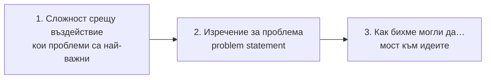
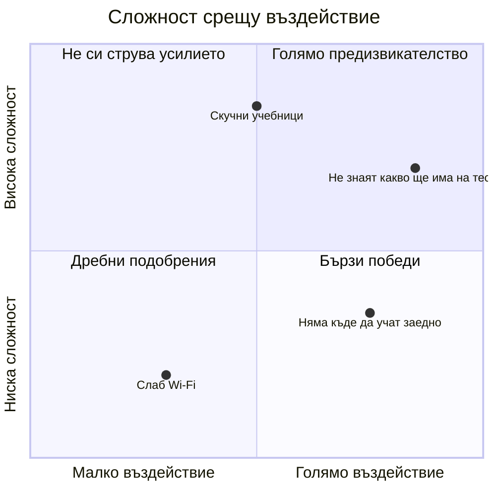

# Модул 09. Етап 2: Дефиниране

## Цели на урока

След този урок ученикът може да:

* обясни защо добре дефинираният проблем е компасът на целия процес;
* подреди проблемите с канвата „Сложност на проблема срещу въздействие“;
* формулира проблема в едно ясно изречение (problem statement);
* напише добро изявление „Как бихме могли да…“.

## 1. Защо дефинирането е компас

На този етап преформулираме начина, по който гледаме на проблема. Поставяме в центъра нуждите на потребителите и подреждаме, анализираме и синтезираме информацията от първия етап. Целта е ясен извод: върху кои проблеми се съсредоточава екипът.

Добре дефинираният проблем е като компас. Колкото по-ясно е формулиран, толкова по-смислени ще са решенията. Ако не го дефинираме правилно, работим на сляпо.

Канвата „Дефиниране на гледна точка“ има три стъпки:

> **Опитай сам.** Прочети отново бележките си от интервютата в модул 08. Огради с червено всички болки, които се споменават от поне двама души.

## 2. Сложност на проблема срещу въздействие

1. **Съберете данни.** Извадете всички болки и задачи от User/Persona Anatomy Canvas. Всяка на отделно листче.
2. **Оценете сложността (вертикалната ос).** Колко труден за решаване е всеки проблем?
3. **Оценете въздействието (хоризонталната ос).** Колко силно пречи на задачите на потребителя?
4. **Разположете проблемите.** Не е нужно точно число, важно е сравнението.
5. **Изберете ключовите.** Обградете проблемите с голямо въздействие, които отговарят на интересите и възможностите ви.

Останалите проблеми също са важни, но фокусът ви трябва да е върху най-значимите.

> **Опитай сам.** Нанеси поне 6 проблема от своя проект на графиката. Кой е в долния десен квадрант (голямо въздействие, по-ниска сложност)?

## 3. Изречението за проблема

Опишете проблема в едно ясно и кратко изречение. То казва кой има проблема, какъв е той и защо е важен.

Формула: **[Персона] има нужда от [нужда], защото [прозрение от наблюденията].**

Пример: „Учениците от 10. клас в нашето училище имат нужда от спокойно място за учене в групи след часовете, защото у дома нямат условия, а библиотеката затваря в 15:00.“

> **Опитай сам.** Напиши изречението за проблема на своя проект по формулата. Прочети го на глас на човек извън екипа. Разбира ли го от първия път?

## 4. „Как бихме могли да…“

Това изявление е мостът между дефинирането и идеите. Превръща проблема във въпрос, който отваря творческото мислене.

Формула: **Как бихме могли да помогнем на [персона] да [постигне, реши, получи] [нужда]?**

| Качество | Пример |
|---|---|
| Прекалено общо | Как бихме могли да помогнем на хората да преодолеят проблемите с трафика? |
| Прекалено конкретно (вече съдържа решението) | Как бихме могли да построим метро, което свързва кварталите с центъра? |
| Точно на място | Как бихме могли да помогнем на хората да стигат навреме на работа? |

За един проблем може да има няколко изявления. Изберете едно, което най-добре отговаря на интересите и възможностите ви, и го пренесете в етапа „Идеи“.

> **Опитай сам.** Напиши три версии на „Как бихме могли да…“ за своя проблем: една прекалено обща, една прекалено конкретна и една точна. Нека съученик познае коя коя е.

## 5. Чести грешки при дефинирането

* Решението е скрито във формулировката („Как да направим приложение за…“).
* Проблемът е описан от гледната точка на екипа, не на потребителя.
* Изречението е толкова общо, че всяко решение пасва.
* Не е проверено дали проблемът реално съществува при повече хора.

> **Опитай сам.** Провери своето изречение и своето „Как бихме могли да…“ за четирите грешки. Поправи поне една.

## Въпроси за дискусия

1. Защо е изкушаващо да вкараме решението още в дефиницията на проблема?
2. Кога е правилно да се върнем от „Дефиниране“ обратно към „Разбиране“?
3. Може ли двама души да дефинират един и същ проблем по различен начин и двамата да са прави?

## Ключови термини

| Термин | Превод |
|---|---|
| Define | дефиниране |
| Point of view | гледна точка |
| Problem statement | изречение, което формулира проблема |
| Insight | прозрение, неочевидно разбиране |
| How might we | „Как бихме могли да…“ |
| Impact / complexity | въздействие / сложност |
