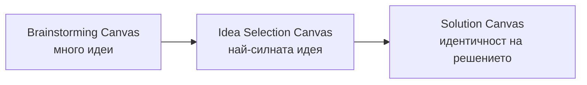
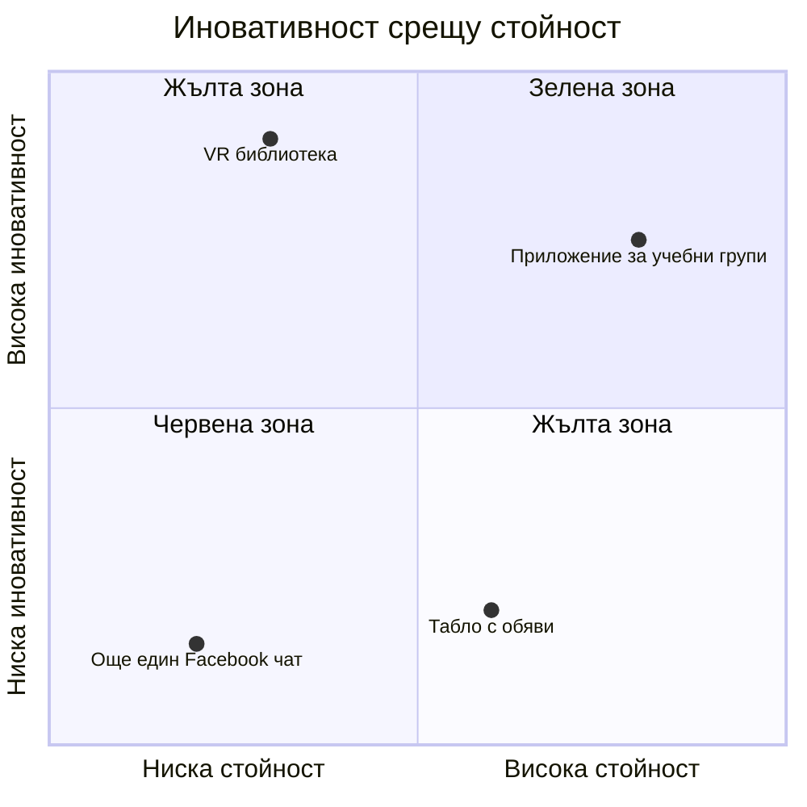

# Модул 10. Етап 3: Идеи

## Цели на урока

След този урок ученикът може да:

* обясни защо креативността е умение, което се тренира;
* проведе брейнсторминг с Brainstorming Canvas и бонус техники;
* групира и оцени идеи с Idea Selection Canvas по иновативност, стойност и сложност;
* опише избраното решение със Solution Canvas.

## 1. От проблема към решенията

Това е една от най-вълнуващите части от процеса: започваме да си представяме реални решения. Целта е първо да създадем много и разнообразни идеи, без ограничения, а после екипът да избере най-добрите: практични, иновативни и отговарящи на нуждите на потребителите.

Помните ли как като деца една картонена кутия можеше да е космически кораб, робот или съкровище? С порастването започнахме да виждаме кутията просто като кутия. Творчеството не изчезва. То само чака да бъде събудено.

> **Опитай сам.** Вземи обикновен предмет (кламер, чаша, химикал). За 3 минути запиши колкото можеш повече необичайни начини да се използва. Колко са?

## 2. Креативността е умение

Няма „некреативни“ хора, има хора, които са забравили как да бъдат креативни. Като музиката: отделните ноти нямат сила сами, но подредени по нов начин създават произведение. Нашите мисли, когато се свързват и преподреждат, раждат нови идеи.

> **Опитай сам.** Комбинирай случайно две неща от списъка и измисли продукт: „учебник“, „тротинетка“, „кафе“, „игра“, „баба“, „AI“, „спорт“, „Viber“. Направи три комбинации.

## 3. Brainstorming Canvas

Визуален инструмент, който структурира екипното генериране на идеи. Подкрепя креативността, разделя генериране, споделяне и подреждане, дава глас на всеки и държи фокуса върху проблема.

**Как се попълва:**

1. **„Как бихме могли да…?“** от етапа „Дефиниране“ е отправната точка.
2. **Ползи и болки.** Целта е да увеличим ползите и да намалим болките. Изпишете ги пред себе си.
3. **Сесия за мозъчна атака.**

**Стъпки:**

1. **Подготовка.** Тихо място, ясни роли (водещ, записващ, следящ времето).
2. **Индивидуално генериране.** Всеки за 10 минути записва от 3 до 100 идеи, по една на листче.
3. **Споделяне и надграждане.** Споделете, надграждайте върху идеите на другите, залепете всичко на стената или на онлайн дъската.

**Правила:** без критика, количеството е важно, луди идеи са добре дошли, надграждаме с „и…“, а не с „но…“.

### Бонус техники

* **Обратна мозъчна атака.** Вместо решения измислете как проблемът може да се влоши. Например: вместо „Как да подобрим трафика?“ мислете „Как да създадем максимални задръствания?“. После обърнете отговорите.
* **Elephant storming (чужда перспектива).** Влезте в ролята на друг: „Как би решил проблема Илон Мъск? А баба ми? А Lidl?“

> **Опитай сам.** Проведете 10-минутен брейнсторминг по вашето „Как бихме могли да…“. После 5 минути обратна мозъчна атака. Коя техника даде по-неочаквани идеи?

## 4. Групиране на идеите

1. Погледнете всички идеи.
2. Прочетете ги заедно.
3. Съберете сходните в групи: например „Технологии“, „Събития“, „Партньорства“.
4. Подредете групите върху канвата.
5. Всеки маркира идеите с три цвята: 🟢 харесвам и мога, 🟡 интересно, но не съм сигурен, 🔴 не.

> **Опитай сам.** Групирайте идеите си в поне 4 групи и дайте име на всяка. Колко зелени и жълти идеи имате?

## 5. Idea Selection Canvas

Взимаме зелените и жълтите идеи и ги оценяваме.

**Иновативност (вертикалната ос):** уникална ли е идеята, има ли много алтернативи, може ли да стане навик, може ли да се мащабира?

**Стойност (хоризонталната ос):** задоволява ли ежедневна нужда, прави ли нещата по-бързи, лесни или евтини, толкова ли е ценна, че хората не биха се отказали от нея?

* **Червена зона:** ниска стойност или ниска иновативност, отпадат.
* **Жълта зона:** критични идеи, проучете ги още.
* **Зелена зона:** обещаващи, съсредоточете се върху тях.

### Оценка на сложността

Запишете идеите от жълтата и зелената зона в таблица и оценете всеки фактор от 1 (ниска сложност) до 5 (висока сложност):

| Идея | Хора | Разходи | Технологии | Време | Одобрения и партньорства | Общо |
|---|:---:|:---:|:---:|:---:|:---:|:---:|
| Приложение за учебни групи | 3 | 2 | 4 | 3 | 2 | 14 |
| Учебна стая след часовете | 2 | 1 | 1 | 2 | 4 | 10 |

Най-добре е идея с висока стойност, висока иновативност и умерена сложност. Формулирайте избраната идея в едно просто изречение.

> **Опитай сам.** Оценете три от най-добрите си идеи по таблицата. Коя има най-нисък общ резултат? Изберете финалната идея и я напишете в едно изречение.

## 6. Solution Canvas: дай идентичност на решението

**Алтернативи и съществуващи решения.** Как проблемът се решава сега? Кои са конкурентите? Защо сегашните решения не работят добре за вашите потребители? Ако решението е напълно ново, намерете най-близката алтернатива. Пример: когато Bolt навлезе в София, клиентите го сравняваха с традиционните таксита.

**Описание на идеята** в едно или две изречения. Пример: „Мобилно приложение, което предлага фризьорски услуги у дома.“

**Предложение за добавена стойност.** Силното първо впечатление: как продуктът решава проблема, каква е ползата за клиента, защо да избере вас. Помислете: каква е уникалната ви оферта, какви предимства имате (по-ново, по-евтино, по-достъпно, по-персонално), каква стойност създавате и за други заинтересовани страни.

Една идея не е решение, докато не докаже, че може да реши проблема. Следващата стъпка е да надградите Solution Canvas с Business Model Canvas.

> **Опитай сам.** Попълнете Solution Canvas за своята идея: поне 3 съществуващи алтернативи (с реални имена), описание в 2 изречения и предложение за стойност в 3 изречения.

## Въпроси за дискусия

1. Защо първите идеи в брейнсторминга обикновено са най-скучните?
2. Как да оценяваме идеите честно, когато една от тях е на най-силния човек в екипа?
3. Кога „луда“ идея от червената зона заслужава втори шанс?

## Ключови термини

| Термин | Превод |
|---|---|
| Ideate | генериране на идеи |
| Brainstorming | мозъчна атака |
| Reverse brainstorming | обратна мозъчна атака |
| Idea Selection Canvas | канва за избор на идея |
| Solution Canvas | канва за решение |
| Value proposition | предложение за стойност |
| Unique selling proposition | уникална продажна оферта |
