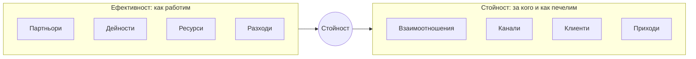
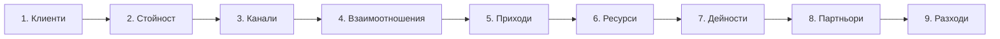

# Модул 11. Business Model Canvas

## Цели на урока

След този урок ученикът може да:

* обясни защо добрата идея не е достатъчна без бизнес модел;
* опише деветте блока на Business Model Canvas;
* попълни канвата в правилния ред;
* анализира бизнес модела на реална компания.

## 1. Голямата картина

Дизайн мисленето ни помага да открием истинските проблеми и смислени решения. Но ако искаме идеята да оцелее, трябва да я превърнем в работещ бизнес модел.

Дори през 2026 г. много компании трудно изграждат стабилен модел. **Business Model Canvas** на Александър Остервалдер и Ив Пиньо остава основният инструмент.

Рийд Хофман, съосновател на LinkedIn, казва, че предприемачите най-често се „загубват“ в детайлите: коя система е най-евтина, кой доставчик е по-добър. В този фокус губят голямата картина. Метафората е „войникът в окопа“: всяка крачка напред е трудна. Business Model Canvas дава поглед от 360 градуса върху целия бизнес.

> **Опитай сам.** Помисли за малък бизнес, който познаваш. Какво знаеш за него и какво не знаеш: откъде печели, кои са основните разходи, кои са партньорите му?

## 2. Какво е Business Model Canvas

Визуална рамка на една страница, която подрежда деветте ключови елемента на бизнеса. Силата ѝ е, че превежда сложните идеи на език, който всеки в екипа разбира.

| Ключови партньори | Ключови дейности | Предложение за стойност | Взаимоотношения с клиентите | Клиентски сегменти |
|---|---|---|---|---|
| | **Ключови ресурси** | | **Канали** | |
| **Структура на разходите** | | | **Приходни потоци** | |

## 3. Деветте блока

1. **Customer Segments (клиентски сегменти).** Кой е клиентът? За кои групи създаваме стойност?
2. **Value Propositions (предложение за стойност).** Какво уникално предлагаме и защо да изберат нас?
3. **Channels (канали).** Как достигаме до клиентите и как им доставяме стойността?
4. **Customer Relationships (взаимоотношения с клиентите).** Как изграждаме и поддържаме връзката?
5. **Revenue Streams (приходни потоци).** Как печелим пари?
6. **Key Resources (ключови ресурси).** Кои активи са нужни, за да работи бизнесът?
7. **Key Activities (ключови дейности).** Какво трябва да правим постоянно?
8. **Key Partners (ключови партньори).** С кого си партнираме?
9. **Cost Structure (структура на разходите).** Кои са основните разходи?

> **Опитай сам.** Свържи всеки блок с пример от твоето училище, сякаш то е бизнес. Кои са клиентите (ученици или родители)? Кое е предложението за стойност? Кои са партньорите?

## 4. Как се попълва

Съберете хора от различни роли: маркетинг, продажби, операции, финанси. Нарисувайте канвата на голяма дъска и попълвайте с лепящи листчета, за да можете да пренареждате. Ако работите сами, споделете готовата канва в предприемаческа общност за обратна връзка.

**Препоръчителен ред:**

Започвате от клиента и стойността (дясната страна) и после минавате към това как ще го направите (лявата страна).

> **Опитай сам.** Попълни канвата за своя проект от модул 10 в този ред, с ключови думи в блоковете. Само за предложението за стойност пиши до 3 изречения.

## 5. Пример: Payhawk

| Блок | Payhawk |
|---|---|
| Клиентски сегменти | Средни и големи компании, международни офиси, организации с нужда от контрол върху разходите |
| Предложение за стойност | Финтех решение „всичко в едно“ за бизнес разходи: корпоративни карти, автоматизирано управление на разходите, фактури, интеграции със счетоводни системи. Клиентите печелят прозрачност, контрол и спестено време |
| Канали | Онлайн платформа, мобилно приложение, продажбени екипи, дигитален маркетинг, партньорства |
| Взаимоотношения | Персонализирана поддръжка, дългосрочни партньорства, уебинари и обучения |
| Приходни потоци | Абонаменти (SaaS), такси за карти, допълнителни услуги и интеграции |
| Ключови ресурси | Технологична платформа, продуктови екипи, финансов лиценз, банкови партньори |
| Ключови дейности | Разработка на софтуер, поддръжка и автоматизация, продажби и нови пазари |
| Ключови партньори | Банки, платежни институции, ERP и счетоводни системи, инвеститори |
| Структура на разходите | ИТ инфраструктура, разработка, продажби и маркетинг, поддръжка, лицензи |

> **Опитай сам.** Отвори сайта на Payhawk. Намери поне едно нещо, което би добавил или поправил в таблицата. Цитирай откъде го знаеш.

## 6. Задача: бизнес моделът на реална компания

Изберете компания: KIKO Milano, ZARA или друга (международна, българска или стартъп). Попълнете деветте блока с ключови думи. Само за предложението за стойност пишете няколко изречения. Помислете как моделът създава стойност, как поддържа конкурентоспособността и какви възможности за иновация се откриват.

**Критерии за оценка:** разбиране на деветте блока; яснота и ключови думи; обосновано и реалистично предложение за стойност; креативност и критично мислене.

**Бонус:** визуализирайте модела в Canva, Miro или на флипчарт.

> **Опитай сам.** Направете канвата за българска компания: Еконт, Ozone.bg, Glovo България или Shelly. Сравнете с канвата на друг екип за друга компания. Кой блок се различава най-много?

## Въпроси за дискусия

1. Кой блок според вас е най-труден за попълване, когато бизнесът още не съществува?
2. Защо започваме от клиента, а не от ресурсите?
3. Може ли две компании с едно и също предложение за стойност да имат напълно различни бизнес модели?

## Ключови термини

| Термин | Превод |
|---|---|
| Business model | бизнес модел |
| Customer segments | клиентски сегменти |
| Value proposition | предложение за стойност |
| Channels | канали |
| Customer relationships | взаимоотношения с клиентите |
| Revenue streams | приходни потоци |
| Key resources / activities / partners | ключови ресурси / дейности / партньори |
| Cost structure | структура на разходите |
| SaaS, software as a service | софтуер като услуга, абонамент |
