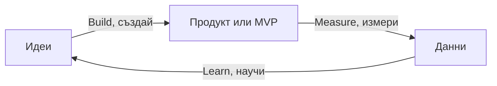
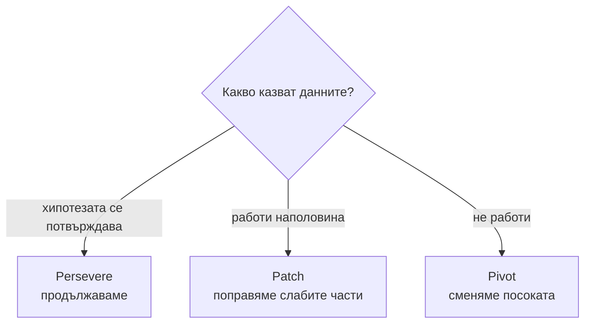

# Модул 12. Lean Startup, MVP и решението „завой или продължаваме“

## Цели на урока

След този урок ученикът може да:

* обясни идеята на Lean Startup и петте му принципа;
* опише цикъла Build, Measure, Learn (създай, измери, научи);
* създаде MVP за собствена идея;
* формулира хипотеза и експеримент;
* реши кога да направи завой (pivot), кога да продължи (persevere) и кога да „закърпи“ (patch).

## 1. Какво е Lean Startup

> „Успехът на стартъп може да бъде моделиран, ако следваме процеса. Това означава, че може да бъде научен, а значи и преподаван.“ Ерик Рийс

Методологията **Lean Startup**, създадена от Ерик Рийс, е научен подход към създаването и управлението на нови компании. Тя намалява несигурността чрез бързи цикли на развитие. Не разчита на дълго и скъпо планиране, а на ранна проверка на идеите чрез минимално жизнеспособен продукт (MVP), който се тества на пазара възможно най-скоро.

Това не е просто „харчи по-малко“ или „проваляй се по-бързо“. Това е да работиш по-умно. Всеки стартъп е голям експеримент, който отговаря не на въпроса „Може ли това да бъде направено?“, а на въпросите „Трябва ли да бъде направено?“ и „Можем ли да изградим устойчив бизнес около него?“.

> **Опитай сам.** Помисли за идея, за която някой е похарчил много време и пари, преди да провери дали хората я искат (може да е от семейството, от училище или от новините). Какво би могъл да тества по-рано?

## 2. Петте принципа

1. **Предприемачите са навсякъде.** Не трябва гараж. Може да си в голяма компания, в държавна институция, в училище.
2. **Предприемачеството е управление.** Стартъпът е организация в условия на голяма несигурност. Изисква гъвкаво управление, ориентирано към експерименти.
3. **Валидирано учене.** Стартъпите съществуват, за да научат как да изградят устойчив бизнес. Ученето се доказва чрез експерименти и обратна връзка от реални клиенти.
4. **Иновационно счетоводство.** Напредъкът не се мери с печалба или пазарен дял, а с това колко експеримента са проведени, кои хипотези са потвърдени и какво е научил екипът.
5. **Build, Measure, Learn.** Създай, измери, научи, после реши: продължаваме или правим завой.

Стартъпите използват и метода **„Петте защо“ (Five Whys)**: питаш „Защо?“ пет пъти поред, за да стигнеш до корена на проблема.

> **Опитай сам.** Приложи „Петте защо“ към проблема: „Половината от класа не предаде проекта навреме.“ Докъде стигна?

## 3. Цикълът Build, Measure, Learn

Целта е да **минимизираме времето за едно завъртане**.

**Идеи.** Определяме фокуса и планираме **експеримент**. Експериментът може да е прост (сменяме текста на бутон в сайта и гледаме дали ще има повече кликове) или сложен (нова функция в приложение). Нужна е **хипотеза**: предположение, което ще докажем или отхвърлим. Пример: „Ако удължим работното време на онлайн чата, ще намалим времето за изчакване.“ Решаваме и как ще измерим резултата.

**Build (създай).** Идеята става първи продукт, MVP. По-късно добавяме функции. Добрите практики включват тестове и постепенно внедряване.

**Measure (измери).** Чрез аналитични инструменти (Google Analytics), тестове на прототипи, наблюдение как реални хора работят с продукта.

**Данни.** Анализираме количествено (метрики, проценти) и качествено (наблюдения, интервюта). Сравняваме с предишни резултати и споделяме в екипа.

**Learn (научи).** Най-важната част: решението. Ако данните показват, че идеята не работи, правим завой. Ако потвърждават хипотезата, продължаваме.

Някои екипи добавят нюанси вместо „успех или провал“: **ефективен провал** (неуспех с ценни уроци), **несъвършен успех** (работи, но има слабости), **голям успех** (доказано и устойчиво решение). В практиката Lean Startup често се комбинира с Agile методите.

> **Опитай сам.** Напиши хипотеза за своя проект във формата „Ако направим X, тогава Y ще се промени с Z, защото…“. Как точно ще я измериш за една седмица?

## 4. MVP: минимално жизнеспособен продукт

MVP е най-простата версия на продукта, която:

* има основните функции;
* носи реална стойност на клиента;
* позволява бързо тестване на пазара;
* изисква минимални ресурси.

MVP не е завършен продукт. Той проверява три неща: интересуват ли се клиентите, полезен ли е продуктът и готови ли са да платят.

**Примери:**

* **Uber.** Първата версия е просто приложение, което свързва шофьори и клиенти. Без споделени пътувания и без много от днешните функции.
* **Dropbox.** Първо няма работеща услуга, а само видео, което показва как ще работи. Записванията от видеото доказват интереса.
* **Instagram.** Започва само с филтри и качване на снимки.

> **Опитай сам.** Измисли MVP за своя проект, който можеш да направиш за 2 дни без програмиране. Например форма в Google Forms, профил в Instagram, страница в Canva или ръчно изпълнение на услугата. Как ще разбереш дали хората го искат?

## 5. Pivot или persevere

Lean Startup съветва основателите да правят редовни срещи **„Завой или продължаваме“**: всеки месец оценяват бизнес модела и решават.

**Persevere (продължаваме).** Оставаш верен на визията, но правиш малки подобрения всеки ден чрез цикъла създай, измери, научи. Напредъкът е валидираното учене, което те приближава до **product/market fit**, съвпадението между продукт и пазар.

Примери: разбираш кои функции хората ползват най-много; тестваш различни текстове и цветове в кампании; откриваш как да превърнеш безплатните потребители в платени.

**Pivot (завой).** Осъзнаваш, че сегашният път не води до съвпадение с пазара или напредъкът е твърде бавен. Радикално променяш хипотезата за продукта, стратегията или бизнес модела. Рядко се случва, но може да спаси компанията.

Примери:

* **Twitter** започва като платформа за подкасти (Odeo) и прави завой към кратки публикации.
* **YouTube** започва като сайт за запознанства с видео и става видео платформа.
* **Slack** се ражда от вътрешен инструмент на екип, който прави онлайн игра.

**Patch (закърпваме).** Изборът не винаги е черно или бяло. Понякога моделът работи наполовина. Тогава поправяш лошите части, без да разрушаваш добрите. Най-реалистичният път често е **Pivot, Patch, Persevere**.

> **Опитай сам.** Разгледай историята на български продукт, който е сменил посоката си (например Telerik или стартъп, за който пишат Forbes България или Капитал). Какъв тип промяна е направил: pivot, patch или persevere?

## Въпроси за дискусия

1. Защо много основатели отлагат завоя, дори когато данните са ясни?
2. Кога MVP е „твърде минимален“, за да даде полезна информация?
3. Как Lean Startup може да се използва в училище, без да правим бизнес?

## Ключови термини

| Термин | Превод |
|---|---|
| Lean Startup | „икономичен стартъп“, методология на Ерик Рийс |
| Build, Measure, Learn | създай, измери, научи |
| Hypothesis / experiment | хипотеза / експеримент |
| Validated learning | валидирано учене |
| Innovation accounting | иновационно счетоводство |
| MVP | минимално жизнеспособен продукт |
| Product/market fit | съвпадение между продукт и пазар |
| Pivot / persevere / patch | завой / продължаване / закърпване |
| Early adopters | първите потребители |
| Five Whys | „Петте защо“ |
