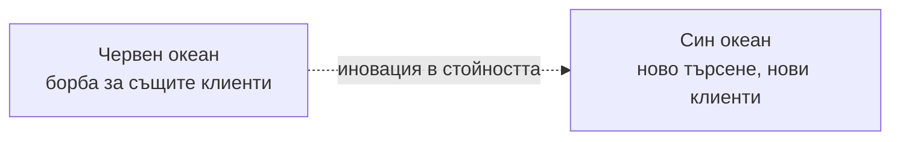
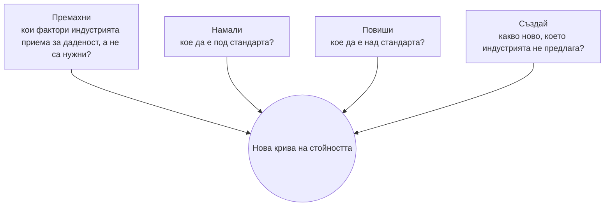
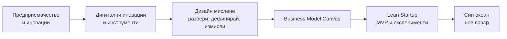

# Модул 13. Стратегията „Син океан“

## Цели на урока

След този урок ученикът може да:

* различи червения от синия океан;
* назове принципите и инструментите на стратегията;
* приложи рамката на четирите действия към реален бизнес;
* обсъди ползите и ограниченията на стратегията;
* направи обобщение на годината и на своя проект.

## 1. Откъде идва стратегията

Стратегията „Син океан“ насърчава компаниите да създават нови пазарни пространства без конкуренция, вместо да се борят в пренаситени пазари. Създават я професорите В. Чан Ким и Рене Моборн от бизнес училището INSEAD. Представят я в книгата си „Blue Ocean Strategy: How to Create Uncontested Market Space and Make the Competition Irrelevant“ (2005), която се превръща в световен бестселър.

> **Опитай сам.** Помисли за пазар, в който всички фирми си приличат и се борят само с цената (например мобилните оператори или пицариите в твоя квартал). Защо според теб се стига до това?

## 2. Червен океан и син океан

| | Червен океан | Син океан |
|---|---|---|
| Пазар | Съществуващ, с ясни граници | Нов, неизследван |
| Конкуренция | Борба за ограничено търсене | Конкуренцията става без значение |
| Цел | Да победиш съперника | Да създадеш ново търсене |
| Резултат | Ценови войни, намаляващи печалби | По-висока стойност при по-ниски разходи |

Интензивната конкуренция „оцветява океана в червено“. Синият океан е пространство, в което създаваш ново търсене и преодоляваш компромиса между стойност и цена.

> **Опитай сам.** Посочи един червен и един син океан в България. Подсказка за син: помисли за услуга, която преди няколко години не съществуваше и създаде собствени клиенти.

## 3. Принципите

1. **Преначертай границите на пазара.** Открий предположенията, които всички приемат за даденост, и ги оспори.
2. **Фокус върху голямата картина.** Мисли стратегически, а не само в числа и детайли.
3. **Излез извън съществуващото търсене.** Обърни внимание на „неклиентите“, хората, които днес не купуват от никого в този пазар.
4. **Следвай правилната последователност:** полезност за клиента, после цена, после разходи, после преодоляване на бариерите за приемане.

> **Опитай сам.** Избери фитнес зала. Кои са нейните „неклиенти“? Запиши три групи хора, които не ходят на фитнес, и защо.

## 4. Инструментите

**Strategy Canvas (стратегическа канва).** Графика, която показва как компаниите в един пазар се представят по факторите, по които се конкурират. Ако всички линии си приличат, сте в червен океан.

**Four Actions Framework (рамка на четирите действия):**

**Пример:** Cirque du Soleil премахна звездите от цирка и номерата с животни, намали опасните трикове, повиши артистичността и създаде сюжет и музика като в театър. Привлече възрастни зрители, които не ходеха на цирк.

**PMS Map и трите нива неклиенти** анализира хората, които са на ръба да станат клиенти, които съзнателно отказват, и които никога не са мислили за този пазар.

> **Опитай сам.** Приложи четирите действия към училищна библиотека, сякаш искаш да привлечеш ученици, които никога не ходят там. Какво ще премахнеш, намалиш, повишиш и създадеш?

## 5. Ползи, критики и ограничения

| Ползи | Критики и ограничения |
|---|---|
| Насърчава иновациите и нестандартното мислене | Трудно е за изпълнение, изисква ресурси и време |
| Разширява пазара с нови клиенти | Риск компанията да се мисли за уникална, без да е |
| Дългосрочен растеж, основан на стойност | Синият океан може да „почервенее“, когато дойдат конкуренти |
| По-малък натиск от конкуренцията | Не всяка индустрия позволява толкова голям скок |
| По-висока рентабилност | |

> **Опитай сам.** Намери пример за някога „син“ пазар, който вече е „червен“ (например стрийминг платформите, доставките на храна или електрическите тротинетки). Какво се случи?

## 6. Обобщение на годината

Този курс е много повече от методологии и примери. Дигиталните иновации не са само технологии, а начин да променяме средата около нас, като започнем от хората и техните нужди. Всеки може да бъде предприемач, стига да има смелостта да опита и да не се страхува да учи по пътя.

> **Опитай сам.** Подгответе 3-минутен пич (pitch) на проекта на екипа: проблемът, персоната, решението, бизнес моделът, какво научихте от MVP и къде е вашият син океан.

## Въпроси за дискусия

1. Може ли малък бизнес в малък град да създаде син океан?
2. Синият океан и дизайн мисленето: как се допълват?
3. Какво бихте направили различно, ако започнете проекта си отначало?

## Ключови термини

| Термин | Превод |
|---|---|
| Blue / red ocean | син / червен океан |
| Uncontested market space | пазарно пространство без конкуренция |
| Value innovation | иновация в стойността |
| Strategy Canvas | стратегическа канва |
| Four Actions Framework | рамка на четирите действия |
| Noncustomers | неклиенти |
| Pitch | кратко представяне на идея пред публика или инвеститори |
